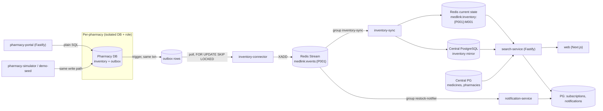
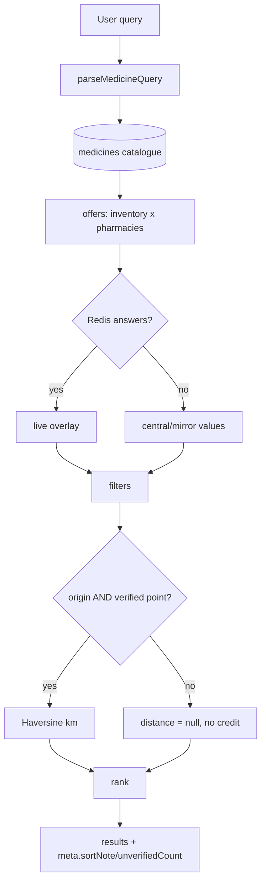
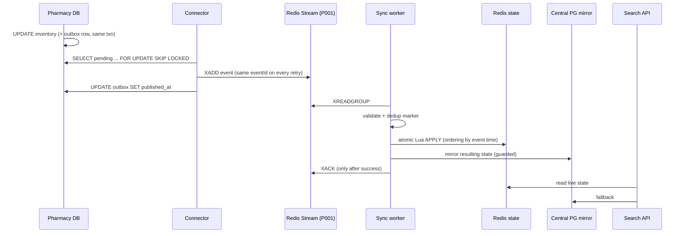
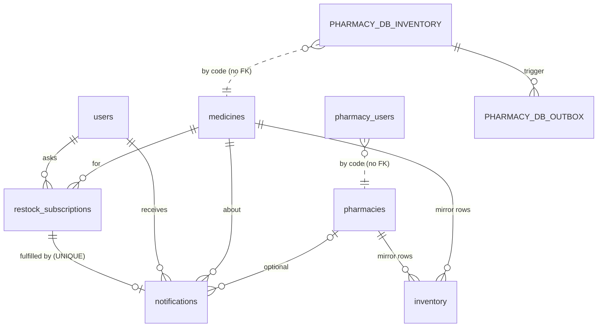

# MedLink — Project Context Document (source of truth for presentation, report and viva preparation)

> Produced by a **read-only investigation** of the repository on 2026-10-23. No code, schema, data, Redis state or environment was changed, and no tests, migrations, seeders or services were run for this document. Where a fact could only come from a live system (database row counts, running services) it is labelled **not re-verified**.

## 0. How to read this document

Every important claim carries one of these evidence tags:

| Tag | Meaning |
|---|---|
| **[V]** | **Verified implementation fact**: read directly in repository code, migrations, JSON data or configuration during this investigation. A path (and often a function name) is given. |
| **[D]** | **Documented intended behaviour**: stated in `docs/*.md`, `PRODUCT.md` or code comments, but not independently traced through the code here. |
| **[H]** | **Historical status report**: a result or number reported earlier (project notes, earlier work sessions). Not re-confirmed now. |
| **[I]** | **Inference**: my reasoning about *why* something was built that way. Not written down by the project. |
| **[P]** | **Planned / future**: not implemented. |
| **[?]** | **Unresolved question or gap**. |

Paths are relative to the repository root `/medlink`. There is no root `README.md`; the nearest equivalents are `PRODUCT.md`, `AGENTS.md` and `docs/`.

---

## 1. Executive summary

**MedLink is a medicine *search and discovery* platform for independent pharmacies.** A patient types a medicine ("Crocin 500mg") and sees which nearby pharmacies list it, at what price, with what stock status and how fresh that information is. MedLink is **not** an online pharmacy: it sells and delivers nothing, and it is not a central inventory system. Each pharmacy keeps its own database, which stays authoritative; MedLink holds only a *synchronised copy* built from events. [V: `PRODUCT.md` "Positioning"; `AGENTS.md` "Core Product Principles"; architecture below]

The engineering core is an **event-driven synchronisation pipeline**: a pharmacy database change → a database trigger writes an *outbox* row in the same transaction → a *connector* publishes it to a per-pharmacy *Redis Stream* → a *sync service* validates, de-duplicates and orders events, updates *current stock in Redis*, and mirrors it to *central PostgreSQL* → the *search API* combines the medicine catalogue with this live state → a *notification service* turns restocks into patient alerts. [V]

Around that sit a Next.js web app, a pharmacy staff portal, a pharmacy simulator (to demonstrate and test the pipeline), a catalogue of 167 medicines, and a **demo directory** of real Mumbai pharmacies shown with explicit "demo listing — not a confirmed partner" labels and **simulated** inventory. [V]

**What is real vs. simulated (the most important honesty point for any presentation):** no real pharmacy has joined MedLink. All pharmacies in the running system are fictional "Pharmacy A–E" rows; their names/addresses are *displayed* as real Mumbai shops from public directories, and all stock is synthetic. [V: `packages/db/src/seed-data.ts`, `packages/db/src/pharmacy-registry.ts`, `docs/demo-pharmacies.md`]

---

## 2. Problem statement, scope and positioning

### 2.1 The problem
A person needing a specific medicine usually walks or phones from shop to shop. Independent pharmacies do not share inventory, so availability is invisible until you arrive. [D: `PRODUCT.md` "Users", "Product Purpose"]

### 2.2 Why this is hard
1. **Independent systems.** Each pharmacy has its own billing/inventory software and its own database. There is no common feed. [D/I]
2. **Ownership and trust.** Pharmacies reasonably do not want to hand control of their stock records to a third party. MedLink therefore keeps the pharmacy database as the *only* authoritative source (`AGENTS.md`: "Each pharmacy's local database is authoritative for its inventory"). [V]
3. **Freshness.** Stock changes every few minutes; a stale answer ("in stock") that is wrong wastes a trip. MedLink makes freshness visible ("Live · updated 12 s ago" vs "Last known"). [V: `docs/frontend.md`, `apps/web/src/components/stock/Freshness.tsx`]
4. **Eventual consistency.** A synchronised view can never be instantly exact; the project is explicit that it is *eventually consistent* and does not promise availability. [V: `AGENTS.md` "Consistency", `PRODUCT.md`]
5. **Search must not query every pharmacy.** Search reads a central synchronised state, not every pharmacy database at request time. [V: `apps/search-service/src/modules/search/service.ts` reads central PG + Redis only]

### 2.3 Who it is for
* **Primary:** patients and caregivers searching for a medicine nearby. **Secondary:** pharmacy staff maintaining their own stock through the portal. [D: `PRODUCT.md`]

### 2.4 How MedLink differs from related systems

| | Online pharmacy | Central inventory/ERP system | **MedLink** |
|---|---|---|---|
| Sells/dispenses medicine | Yes | Not necessarily | **No** |
| Source of truth for stock | The seller | The central system | **Each pharmacy's own database** |
| Central copy | Is the system | Is the system | **Synchronised representation** (Redis + PG mirror) |
| Goal | Fulfil an order | Manage stock | **Help the user choose where to go** |

### 2.5 What MedLink does **not** do [D: `PRODUCT.md` "Capabilities and Constraints"; V where noted]
* Does not sell, dispense, take payment, manage prescriptions or give medical advice. [V: no such code exists in the repository]
* Does not guarantee availability or prices ("informational; users may need to confirm").
* No pack-size data in the catalogue/API (`PRODUCT.md` says do not promise it). [V: `medicines` table has brand, generic, dosage, form only]
* No patient sign-in; restock alerts identify the user by email only. [V: `apps/search-service/src/modules/notifications/routes.ts` header comment]
* Restock alerts are in-app/simulated; external email is not implemented. [V: `Notifier` is a mock that logs; see §4D]

### 2.6 Objectives, assumptions, constraints
* **Objectives** [D]: discoverable availability, pharmacy data ownership, an auditable and recoverable sync pipeline, honest labelling of simulated data.
* **Assumptions** [I]: pharmacies can run (or have run for them) a connector pointed at their database; the outbox trigger can be installed in a pharmacy's database; patient location is supplied by the browser or a chosen area.
* **Constraints** (hard rules from `AGENTS.md`) [V]: do not bypass the outbox; do not let the portal write Redis; preserve per-pharmacy Redis hash tags (cluster compatibility); preserve event schema/versioning; keep stale events from overwriting newer state; distinguish *unavailable*, *zero* and *unknown* stock.

### 2.7 Concept vs. implementation

| Part of the core concept | Status |
|---|---|
| Search/discovery layer, not an online pharmacy | **Implemented** [V] |
| Pharmacies keep their own databases | **Implemented for the 5 simulated pharmacies** (separate DB + role each) [V: `packages/db/src/pharmacy.ts`]; **no real pharmacy is onboarded** [V] |
| Existing billing/inventory systems integrate | **Partially**: the *contract* is a table schema + trigger (`packages/db/pharmacy-migrations/002_outbox.sql`) and a connector; no integration with any real third-party pharmacy software exists [V/?] |
| Synchronised central view | **Implemented** (Redis state + PG mirror) [V] |
| Verified real-pharmacy network | **Not implemented**; directory is demo-only [V] |

---

## 3. Architecture and components

### 3.1 Big picture



### 3.2 Component inventory

| # | Component | Purpose | Key files | Inputs → outputs | Depends on | Status / limitations |
|---|---|---|---|---|---|---|
| 1 | **Web app** (`@medlink/web`) | Patient UI: search, list/map, filters, pharmacy pages, notifications, portal sign-in UI, landing page | `apps/web/src/app/**`, `components/search/SearchPage.tsx`, `components/pharmacies/*`, `lib/api.ts`, `lib/maps.ts` | HTTP from `search-service` → HTML UI | Next.js 16, React 19, Leaflet, GSAP | Implemented [V]. Pack size not shown. Map uses Leaflet. |
| 2 | **Search API** (`@medlink/search-service`) | Catalogue + live availability search, ranking, pharmacy pages, directory, restock subscriptions | `apps/search-service/src/app.ts`, `modules/{search,ranking,live,medicines,pharmacies,notifications,inventory}` | HTTP query → JSON | central PG, Redis (optional), `@medlink/db` | Implemented [V]. Notification endpoints identify by email, no auth. |
| 3 | **Pharmacy portal** (`@medlink/pharmacy-portal`) | Staff sign-in; edit own stock | `apps/pharmacy-portal/src/{routes,auth,admin,config}.ts` | HTTP → plain SQL on pharmacy DB | `pharmacy-ops`, central PG (accounts) | Implemented [V]. Missing: email verification, password reset, rate limiting, audit trail (`docs/pharmacy-portal.md`) [D]. |
| 4 | **Pharmacy-local databases** | Authoritative stock per pharmacy | `packages/db/pharmacy-migrations/001_init.sql`, `002_outbox.sql`; `packages/db/src/pharmacy.ts` | SQL in → outbox rows | PostgreSQL | 5 simulated; created by `pharmacies:setup` [V]. |
| 5 | **Central PostgreSQL** | Medicine catalogue, pharmacy records, inventory mirror, users, subscriptions, notifications, portal accounts | `packages/db/migrations/001–005_*.sql` | — | PostgreSQL 16 | Implemented [V]. |
| 6 | **Outbox** | Capture every inventory change atomically | `002_outbox.sql` (`inventory_to_outbox` trigger) | `inventory` INSERT/UPDATE/DELETE → `outbox` row | PG | Implemented [V]. |
| 7 | **Inventory connector** | Outbox → validated event → Redis stream | `apps/inventory-connector/src/{connector,convert,redis-publisher,main}.ts` | outbox rows → `XADD` | pharmacy DB, Redis, `event-schema` | Implemented [V]. At-least-once. |
| 8 | **Redis Streams / Cluster** | Event transport; per-pharmacy ordering | `packages/event-schema/src/streams.ts`, `packages/redis/src/index.ts`, `docker-compose.yml` | — | Redis 7 | Implemented [V]; cluster mode supported, tests skip unless cluster is configured [V]. |
| 9 | **Inventory sync service** | Consume, validate, dedupe, order, apply, mirror, dead-letter | `apps/inventory-sync/src/{service,stream-worker,dedup,state,handlers,handler,mirror}.ts` | stream entries → Redis state + PG mirror | Redis, central PG | Implemented [V]. |
| 10 | **Redis current state** | Current stock/price per pharmacy+medicine | `state.ts` (Lua `APPLY` script) | events → hashes | Redis | Implemented [V]. |
| 11 | **PG inventory mirror** | Fallback when Redis is down/unaware | `apps/inventory-sync/src/mirror.ts`; central `inventory` table | Redis item → PG row | central PG | Implemented, best-effort [V]. |
| 12 | **Notification service** | Detect restocks, fulfil subscriptions, "send" | `apps/notification-service/src/{service,handler,restock,store,notifier}.ts` | RESTOCK events → `notifications` rows | Redis, central PG | Implemented; notifier is a **mock** (log) [V]. |
| 13 | **Pharmacy simulator** | Behaves like pharmacy software; demo CLI; embedded pipeline; demo seeder | `apps/pharmacy-simulator/src/*`, `packages/pharmacy-ops/src/{simulator,demo-seed,catalogue}.ts` | commands → pharmacy DB writes | all of the above | Implemented [V]. |
| 14 | **Shared packages** | `@medlink/db` (pool, migrations, seed, catalogue importer, registry), `@medlink/event-schema` (Zod contract + Redis key names), `@medlink/redis` (client, scan/delete helpers), `@medlink/pharmacy-ops` (stock operations, demo plan) | `packages/*` | — | — | Implemented [V]. |
| 15 | **Pharmacy directory & Maps directions** | Real-name demo listings, address/coordinate metadata, directions links | `packages/db/pharmacy-directory/mumbai-demo.json`, `packages/db/src/pharmacy-registry.ts`, `apps/web/src/lib/maps.ts`, `components/pharmacies/{DirectionsActions,DirectoryListings}.tsx` | JSON → API/UI | — | Implemented [V]; **demo only**. |
| 16 | **Tests & tooling** | Vitest unit/integration/UI, `tsc`, ESLint | `**/test/*.test.ts(x)`, `tests/*.test.ts`, `vitest.config.ts`, `eslint.config.mjs` | — | — | See §10. |

### 3.3 Repository layout [V]

```
apps/        inventory-connector  inventory-sync  notification-service  pharmacy-portal
             pharmacy-simulator   search-service  web
packages/    db  event-schema  pharmacy-ops  redis
docs/        catalogue  demo-pharmacies  demo-seed  frontend  pharmacy-portal  pharmacy-simulator
             redis-streams  restock-notifications  experiment-9-report
tests/       catalogue-pipeline  demo-seed  live-search  pharmacy-portal  pipeline  restock-notifications  (cross-service)
docker-compose.yml   (postgres 16, redis 7, optional 6-node redis cluster profile)
```

npm workspaces monorepo (`package.json` `workspaces: ["packages/*","apps/*"]`). [V]

---

## 4. End-to-end workflows

### A. Medicine search

**Numbered sequence** [V unless tagged]
1. The user types a query on `/search` (or the landing page redirects there). The page state lives in the URL (`?q=…&stock=1&sort=price`). `apps/web/src/components/search/SearchPage.tsx`; `docs/frontend.md`.
2. The web app calls `GET /api/search?q&lat&lng&limit&inStock&maxDistanceKm&maxPrice&sort` (`apps/web/src/lib/api.ts` → `searchMedicines`-style fetch). Location comes from the header location chip (an area, "use my current location", or coordinates).
3. `searchRoutes` validates input with Zod (`apps/search-service/src/modules/search/routes.ts`): `q` 1–100 chars, `lat/lng` decimals in range, `sort ∈ {best,distance,price,stock}`.
4. `parseMedicineQuery` (`modules/medicines/query.ts`) splits the text into **name terms** and **dosage tokens** ("Crocin 500 mg" → `terms:["crocin"], dosages:["500mg"]`), max 5 terms. `searchMedicines` (`modules/medicines/repo.ts`) queries the catalogue (`medicines` table, trigram indexes on lower(brand/generic)).
5. `offersForMedicines` (`modules/search/service.ts`) joins `inventory` ⨝ `pharmacies` ⨝ `medicines` for the matched medicine IDs → **base offers** (the central/mirror view). Each pharmacy goes through `presentPharmacy` (directory display mapping, demo flags, `locationVerified`).
6. `overlayLive` (`modules/live/overlay.ts`) lays **live Redis state** over the base offers (see table below). If Redis is down/slow (>400 ms per `docs/frontend.md`) everything falls back to the central values and the response says `live:false`.
7. Filters are applied *before* ranking: `inStock`, `maxPrice`, `maxDistanceKm`.
8. Distance: **Haversine** (`modules/geo/haversine.ts`) from the user to the pharmacy **only when the user origin is finite and `pharmacy.locationVerified` is true**; otherwise `distanceKm = null`.
9. Ranking: `rankOffers` (`modules/ranking/rank.ts`) — Strategy pattern (`WeightedMultiCriteriaStrategy`, `DistanceFirstStrategy`, `PriceFirstStrategy`, `RankingStrategyFactory`). Default weights **availability 0.4, distance 0.3, price 0.2, relevance 0.1** (`ranking/config.ts`, env-overridable `RANK_WEIGHT_*`). In-stock offers always precede sold-out ones. An unknown distance earns **no distance credit and is not renormalised**, so an unverified pharmacy cannot outrank an otherwise equal verified one. `compareDistance` puts nulls last.
10. `sort=distance` with no verified distance falls back to `best` and returns `meta.sortNote` explaining it (never presenting another order as "nearest").
11. The response `data[]` + `meta` (`count, matches, sortApplied, sortNote, unverifiedCount, unverifiedFiltered, weights, live, sort, filters`) goes back; the UI renders list or Leaflet map, with Live/Last-known freshness.

**Live overlay rules** (`docs/frontend.md` [D], implemented in `overlay.ts` [V]):

| Redis says | Result |
|---|---|
| a record | its quantity/price/time win; marked **Live** |
| record marked removed | dropped (pharmacy stopped stocking it) |
| record with price but no quantity yet | missing field from catalogue (never reads as "0 left") |
| medicine only in Redis | added |
| nothing | catalogue's last known value; marked **Last known** |
| Redis down | all catalogue; page says last-known |

**The five situations the user asked to be distinguished**

| Situation | Where it is decided | What the user sees |
|---|---|---|
| In the **catalogue** | row in `medicines` | Findable. Presence alone says nothing about stock. |
| **Listed** by ≥1 pharmacy | `meta.matches[].listed` (true if any inventory row exists, before filters, even at zero stock) | Offers shown, or filter message |
| A pharmacy **reports stock** | offer `quantity>0` → `stockStatus` IN_STOCK/LOW_STOCK (≤ `LOW_STOCK_THRESHOLD`) | Stock badge + freshness |
| **No inventory offer** | matches exist but `listed:false` | "No pharmacy has listed this medicine yet" |
| Not in catalogue | no matches | "“…” isn't in the MedLink catalogue" |
| **Directory-only** pharmacy | exists only in `mumbai-demo.json` (`candidates`/P006); no DB, no inventory rows | Never appears in `/api/search`; appears only under "Directory listings: no inventory" on `/pharmacies` |

Zero stock vs unknown: a listed row with `quantity 0` is `OUT_OF_STOCK` (known zero); a pharmacy that does not list the medicine produces *no offer* (unknown/not listed). `AGENTS.md` requires keeping these distinct. [V/D]

**Unverified locations**: no distance, no map pin (`apps/web/src/lib/map-data.ts` `toPins` skips `locationVerified === false`), card text "Distance not shown"/"Location not verified"; a divider separates unverified results when sorting by distance. [V]



### B. Inventory update and synchronisation

**Numbered sequence** [V]
1. A pharmacy changes `inventory` in **its own database** (portal, simulator, pharmacy software, or plain SQL).
2. The trigger `inventory_outbox` (`AFTER INSERT OR UPDATE OR DELETE ... FOR EACH ROW`, function `inventory_to_outbox`) inserts `outbox` rows **inside the same transaction**: INSERT → `MEDICINE_ADDED`; DELETE → `MEDICINE_REMOVED`; UPDATE → `PRICE_UPDATED` if price changed, and `SALE` (decrease) / `RESTOCK` (increase) if quantity changed (one UPDATE changing both yields two events, price first). A rolled-back change leaves no event. `medicine_code` is immutable. (`packages/db/pharmacy-migrations/002_outbox.sql`)
3. Each outbox row gets a `event_id UUID DEFAULT gen_random_uuid() UNIQUE`, assigned **once**, so every re-publication carries the same `eventId`.
4. `InventoryConnector.runOnce` (`apps/inventory-connector/src/connector.ts`): checks the DB's `pharmacy_profile.pharmacy_code` equals the configured pharmacy (refuses a mismatched database), then in one transaction selects pending rows `ORDER BY id LIMIT n FOR UPDATE SKIP LOCKED`, converts each via `toEvent` (Zod `assertInventoryEvent`), publishes via `RedisStreamPublisher`, and only then sets `published_at`. A row that can never be a valid event is parked (`failed_at`, `error`) so it cannot block the queue. If publish fails the loop backs off exponentially (max 30 s) and the rows stay in the outbox.
5. The stream entry goes to `medlink:events:{P001}` (one stream per pharmacy; field `event` holds JSON) and the key is added to the registry set `medlink:streams`; streams are capped with approximate `MAXLEN ~ 100000` [D].
6. `SyncService` discovers streams from the registry every 3 s and runs one `StreamWorker` per stream (`service.ts`, `stream-worker.ts`) in consumer group `inventory-sync` (group created at `0` so earlier events are not skipped).
7. `StreamWorker.process`: parse + validate (`parseInventoryEvent`: MALFORMED / UNSUPPORTED_VERSION / INVALID); events in the wrong pharmacy's stream are rejected; invalid ones are **dead-lettered** to `medlink:events:dlq` and acknowledged; otherwise `handler.handle`; `XACK` only **after** successful handling.
8. Failed handling leaves the entry pending; `XAUTOCLAIM` re-delivers after `SYNC_MIN_IDLE_MS`; after `SYNC_MAX_DELIVERIES` it is dead-lettered with `MAX_DELIVERIES`.
9. Handler chain (`handlers.ts: createSyncHandler`): `DedupHandler( CompositeHandler[ SyncStatusHandler, MirroredState(InventoryStateHandler) ] )`.
10. `DedupHandler` (`dedup.ts`): marker `medlink:dedup:{P001}:<eventId>` = `processing` (30 s lease) → `done` (168 h). Duplicate of `done` → skipped and counted; `processing` → `EventInFlightError` (retry later).
11. `InventoryStateHandler.apply` runs one **atomic Lua script** (`APPLY`, `state.ts`) over four same-slot keys: dedup marker, item hash, pharmacy index set, sync-status hash. It stores `quantityAfter` (never old+delta), with separate timestamps for quantity and price; an event only changes a field if its time is not older than the field's stored time; removed items are tombstones until a newer `MEDICINE_ADDED`. Returns applied / stale / duplicate, and sets the dedup `done` marker **in the same script** (so a crash cannot leave "applied but unmarked").
12. Before the script, a cross-pharmacy hint set `medlink:medicine:{M001}:pharmacies` gets `SADD` (different slot, so not atomic; it is written *first* so it can be a superset but never missing an entry).
13. `CatalogueMirror.mirror` (`mirror.ts`) copies the item's *resulting* state into central `inventory` with an `updated_at <= asOf` guard (never overwrite newer with older). If the central DB has no such pharmacy or medicine, it **does not count the item as mirrored**: `stats.unmatched++` and a warning is logged. DB errors are logged and counted (`failed`), not thrown; the next event for that item heals it.
14. Search reads Redis first (live) and PG as fallback (§4A). Typical visibility lag is "a second or two" [D: `docs/restock-notifications.md`]; no latency SLO is measured [?].



**Guarantees: implemented vs. assumed**

| Topic | Implemented behaviour [V] | Assumption / not guaranteed |
|---|---|---|
| Event IDs | UUID assigned once in outbox | — |
| Pharmacy IDs | Connector verifies DB identity; stream is per pharmacy; worker rejects event in wrong stream; Zod regex `^P\d{3,}$` | Pharmacy ID is a *label*; there is no cryptographic authentication of a publisher to Redis [?] |
| Ordering | Per pharmacy for first deliveries; correctness under reorder via event-time rules | A retried entry can arrive after later ones (handled by timestamps) |
| Retries | at-least-once connector→Redis and Redis→handler | Backoff for streams is fixed `SYNC_MIN_IDLE_MS`, not exponential [D] |
| Dedup | atomic with state change; 168 h retention | After retention, an old `eventId` looks new [D] |
| Failure/recovery | outbox retains events if Redis down; AOF persistence on Redis container; consumer-group takeover | Async replication in Redis Cluster can lose last acknowledged writes on master failure; **no WAIT/reconcile implemented** [D: `docs/redis-streams.md`] |
| Unmatched pharmacy | Mirror reports `unmatched`, Redis state still updated | Redis can hold state for a pharmacy absent from central PG, so search for it still depends on a central row [V/I] |
| Stream trimming | `MAXLEN ~ 100000` | If consumers lag past that, oldest unprocessed events are lost [D] |
| Reconciliation | none beyond "next event heals" | [?] no full-resync tool in the repo |

### C. Pharmacy onboarding and configuration

Terminology (all [V]):

| Term | Meaning in the code |
|---|---|
| **Directory listing** | Entry in `mumbai-demo.json` (`pharmacies` or `candidates`). Public-source metadata only. |
| **Fictional demo pharmacy** | P001–P005 rows in `seed-data.ts` ("Pharmacy A – Andheri West" …) with real per-pharmacy databases. |
| **Display mapping** | P001–P005 are *shown* with directory names/addresses via `presentPharmacy`; nothing persisted is renamed. |
| **Configured pharmacy** | A directory pharmacy whose `PHARMACY_<code>_DATABASE_URL` is set → joins `activePharmacies()`. Only P006 can. |
| **Registered pharmacy** | A row in central `pharmacies` (`registerPharmacies`, `npm run demo:register`; dry-run default; refuses display mappings and unverified points). |
| **Onboarded participant** | A real pharmacy that agreed, has its own DB, connector, portal account. **None exists.** |

How it works:
* Pharmacy DB URLs come from env `PHARMACY_P00N_DATABASE_URL` (`loadPharmacyUrls`, `loadActivePharmacyUrls`). `npm run pharmacies:setup` provisions role+database (REVOKE CONNECT FROM PUBLIC), applies pharmacy migrations, writes the profile and starting stock. [V: `packages/db/src/pharmacy.ts`]
* Pharmacy ID validation: DB `CHECK (pharmacy_code ~ '^P[0-9]{3,}$')`, event Zod regex, portal sign-up regex and existence check in central `pharmacies`.
* Portal accounts: `POST /portal/signup` creates `pharmacy_users` with `status='pending'` (rate-capped at 20 pending per pharmacy, same 202 response whether or not the email exists). Only an administrator (CLI `npm run portal:users -- approve <email>`) activates it; there is deliberately no HTTP approval endpoint. Login requires `active`; the session is a signed HMAC cookie and `requireSession` re-checks the account on every request; **the pharmacy always comes from the session, never from the request**. [V: `apps/pharmacy-portal/src/routes.ts`, `auth.ts`]
* Directory-only candidates (P007–P020) are not pharmacies in any sense: not known, not active, not registrable, not seedable (`validateCandidate`, tests in `packages/db/test/pharmacy-registry.test.ts`). [V]
* `demo:directory-setup` (new) can prepare an *empty* profile/schema for a directory pharmacy in a local/test environment; it is dry-run by default and was never run against dev. [V code; not executed]

### D. Notifications

1. Patient asks "Notify me when it's back" for a medicine out of stock everywhere: `POST /api/restock-subscriptions {email, medicineId}` → `restock_subscriptions` row `ACTIVE`; user auto-created in `users` by email. (`modules/notifications/repo.ts`)
2. `NotificationService` joins the *same* per-pharmacy streams in its own consumer group `restock-notifier`, so neither service slows the other. [V `service.ts`, `NOTIFIER_GROUP`]
3. `RestockNotificationHandler.handle` → `detectRestock`: only `RESTOCK` with `quantityAfter > 0` qualifies (not SALE/PRICE/ADDED/REMOVED).
4. `fulfilSubscriptions` (one SQL statement) flips matching `ACTIVE` subscriptions to `NOTIFIED` and inserts `notifications` rows; only subscriptions created at or before the event time are fulfilled [D, `docs/restock-notifications.md`]. A DB failure **throws** so the stream retries (safe: idempotent); `notifications.subscription_id` is `UNIQUE` as a last line of defence.
5. `deliverPending` sends via a `Notifier` strategy (mock logs `[mock notification] …`) and sets `delivered_at`; failures are caught (the event is *not* retried) and a periodic sweep (`NOTIFY_SWEEP_INTERVAL_MS`) sends pending rows (`FOR UPDATE SKIP LOCKED`). Delivery is at-least-once.
6. The web app polls `GET /api/notifications?email=&limit=` and shows an unread bell.

Limits [V/D]: identity = email only (anyone knowing an address can read/cancel its subscriptions); no real channel (email/SMS); the API doesn't verify the medicine is actually out of stock (the UI only offers the button then); clock skew between pharmacy and central DB can miss a subscriber in a small window.

### E. Google Maps directions and location ranking

* **Verified location rule** [V: `pharmacy-registry.ts` `validateDirectoryEntry`, `locationRule` in JSON]: a point is *verified* only when **two independent map sources agree within 100 m**. Otherwise only observed *candidate* points are kept and never used for directions, pins or distance. Today **only P004 (Bandra Medical Stores) is verified** (OpenStreetMap node + magicpin point ~10 m apart: 19.05548, 72.83152).
* **Distance**: Haversine, only with a valid user origin and a verified pharmacy point (§4A step 8). `GET /api/pharmacies/:id?lat&lng` follows the same rule.
* **Nearest-first**: `sort=distance` orders verified results nearest first; unverified follow, set apart; if none verified the API falls back to `best` and says so.
* **Directions** (`apps/web/src/lib/maps.ts`): `https://www.google.com/maps/dir/?api=1&destination=<lat,lng>` for a verified point, otherwise `destination=<percent-encoded address>`; `&origin=lat,lng` is added **only if the user explicitly chose a location** (`LocationProvider.explicit`); the built-in default area is never sent as origin. Links open with `target=_blank rel="noopener noreferrer"`. **No API key, no SDK.**
* Directory-only leads (`DirectoryListings.tsx`): `directions` mode `address` / `approximate` (unconfirmed lead, labelled) / `unavailable` (incomplete address or excluded). No pin or distance ever.
* Avoiding misleading output: API returns `distanceKm:null`, `distanceVerified:false`; UI shows "Distance not shown"; `toPins` omits unverified pharmacies; map popups carry the demo label and simulated-inventory line.

### F. Demo inventory and simulation

* **Simulator** (`apps/pharmacy-simulator`, `packages/pharmacy-ops/src/simulator.ts`): writes **only to a pharmacy's own database** (sell, restock, price, add, remove, with "no overselling" locking). It never writes Redis; the trigger/connector/sync carry events. It can run the real services embedded (`npm run demo`, `startEmbeddedPipeline`) and "watch" each stage (`tracer.ts`, `compare.ts`). `docs/pharmacy-simulator.md`.
* **Demo seeder** (`npm run demo:seed`, `packages/pharmacy-ops/src/demo-seed.ts`, `apps/pharmacy-simulator/src/demo-seed.ts`):
  * `planDemoSeed` is a **pure deterministic function** of (seed text, catalogue, pharmacies): SHA-256-derived numbers decide who lists what, tiers (common 0.65 / mid 0.35 / rare 0.12 listing probability), ~10% zero stock, ~20% low stock, prices = log-uniform base × pharmacy `priceFactor` × jitter. Intentional cases: Amlong at all five (different prices), Retaunch only at P002, Cabgolin listed-but-zero at P004, Nefrozon/Dutas listed by nobody.
  * **Dry run is the default**; `--write` is required; `--list` shows rows that look seeded.
  * **Idempotent and insert-only**: reads the pharmacy's current stock; an already-listed medicine is skipped (never updated/deleted); a second run adds nothing. Writes go through `PharmacySimulator.addMedicine` → pharmacy DB → outbox → normal pipeline.
  * **Guards** (`assertDemoSeedAllowed`): refuses if `NODE_ENV=production`, `MEDLINK_ENV`/`APP_ENV` not dev/local/test, `DATABASE_URL` unset, any DB host not `localhost/127.0.0.1/::1`, or a DB name containing "prod".
  * **Default targets = P001–P005 only.** Directory pharmacies (P006+) are never seeded because a URL happens to be configured; they need `--include-directory=P006` **and** a prior `demo:directory-setup`, and the DB must hold no stock the seed did not write (`directoryTargetProblem`).
  * Documented default result: 322 rows (P001 55, P002 64, P003 78, P004 56, P005 69) [D/H: `docs/demo-seed.md`; not executed on the dev database].
* **Synthetic vs real**: the API sets `demo`, `independent`, `locationVerified`, `inventorySimulated`; every demo card/popup/page shows "Demo directory listing — not a confirmed MedLink partner." and "Inventory shown is simulated and not confirmed by <name>." (`apps/web/src/components/ui/DemoBadge.tsx`). The schema deliberately has no column marking demo rows; they are identified by reproduction (`--list`). [V]

---

## 5. Technology stack

| Technology | Where used | Why | Problem it solves in MedLink | Evidence | Status |
|---|---|---|---|---|---|
| **TypeScript** (strict, ES modules) | Every package/app | One typed language across UI, APIs, workers, shared contracts | Event/API shapes shared at compile time between independently run services | `tsconfig.json`, `npm run typecheck` | Implemented |
| **Node.js** | All services, tests | Runtime; `tsx` runs TS directly | One runtime for connector, sync, notify, API | `package.json` scripts, `@types/node` | Implemented |
| **npm workspaces** | Repo root | Monorepo with shared `@medlink/*` packages | Shared event schema/DB/Redis code without publishing packages | root `package.json` `workspaces` | Implemented |
| **Next.js 16 / React 19** | `apps/web` | App-router UI, routing/redirects | Patient UI, URL-as-state search | `apps/web/package.json`, `next.config.ts` | Implemented (`apps/web/AGENTS.md` warns of breaking changes) |
| **Tailwind v4** [I from `postcss.config.mjs`/classes] | `apps/web` | Utility styling with theme tokens | Single light theme, accessible styling | `globals.css`, `app-theme.css` | Implemented |
| **Leaflet** | `ResultsMap.tsx` | Open-source map rendering | Show verified pharmacies as pins | `apps/web/package.json` | Implemented |
| **GSAP** | Landing page | Animations | Marketing/landing only | `package.json` | Implemented (cosmetic) |
| **Fastify** | search-service, pharmacy-portal | Fast HTTP framework with hooks | JSON APIs, CORS, error handler, request IDs | `apps/search-service/src/app.ts` | Implemented |
| **Zod** | search-service, portal, event-schema | Runtime validation | Validate untrusted input and the event contract at boundaries | `event-schema/src/index.ts`, route files | Implemented |
| **PostgreSQL 16** (+ `pg`, `pg_trgm`) | Central DB + one DB per pharmacy | Durable relational store; trigram search | Catalogue, mirror, accounts, subscriptions; per-pharmacy authoritative stock + outbox | `docker-compose.yml`, `migrations/*.sql` | Implemented |
| **PostgreSQL trigger (plpgsql)** | Pharmacy DB | Capture changes regardless of who writes | Transactional outbox | `pharmacy-migrations/002_outbox.sql` | Implemented |
| **Redis 7 / ioredis** | Streams, state, dedup | Fast shared state and log | Event transport + current stock for search | `packages/redis`, compose | Implemented |
| **Redis Streams + consumer groups** | Connector→sync/notify | Ordered, persistent log with ack/retry | At-least-once delivery, takeover of crashed consumers | `stream-worker.ts`, `docs/redis-streams.md` | Implemented |
| **Redis Lua scripts** | `state.ts`, `dedup.ts` | Atomic multi-key updates | State change + dedup marker in one step | `APPLY` script | Implemented |
| **Redis Cluster mode** | `packages/redis`, compose profile | Horizontal scaling | Hash tags `{P001}` keep a pharmacy's keys in one slot | `streams.ts`, `cluster.test.ts` | Implemented; tests only run in cluster mode |
| **pino** | connector, sync, notify | Structured logging | Traceable events (eventId, lagMs) | `logger.ts` files | Implemented |
| **Vitest + Testing Library + jsdom** | All tests | Unit/integration/UI tests | See §10 | `vitest.config.ts` | Implemented |
| **ESLint (typescript-eslint)** | Repo | Linting | Code quality | `eslint.config.mjs` | Implemented |
| **Docker Compose** | Local infra | Postgres/Redis/cluster | Reproducible dev environment | `docker-compose.yml` | Implemented |
| **scrypt + HMAC cookies** (Node `crypto`) | Portal | No external auth dependency | Password hashing, signed stateless sessions | `apps/pharmacy-portal/src/auth.ts` | Implemented (dev-grade, see §9) |
| **Google Maps URLs** | Web | Zero-key directions | Navigation without an SDK/API key | `lib/maps.ts` | Implemented |

---

## 6. Data model and database design

### 6.1 Four kinds of data (keep these distinct in any explanation)

| Kind | Where | Authoritative? |
|---|---|---|
| **Catalogue data** (what products exist) | central `medicines`; batch file `packages/db/catalogue/batch-001.json` | Authoritative for *identity of products only*; says nothing about stock |
| **Pharmacy-owned inventory** | each pharmacy's own `inventory` | **Authoritative** for that pharmacy |
| **Synchronised current state** | Redis `medlink:inventory:{P}:{M}` | Derived; rebuilt from events |
| **Mirror/fallback** | central `inventory` | Derived copy; not authoritative |
| **Directory metadata** | `mumbai-demo.json` (not in any DB) | Public-source metadata for demo listings; not a registry of partners |

### 6.2 Central database (`packages/db/migrations`) [V]

* **`users`** (id, name, email UNIQUE, optional lat/lng with CHECK that both-or-neither). Used for restock-alert identity.
* **`medicines`** (id, brand_name, generic_name, dosage, form, created_at, **code** `Mnnn` UNIQUE via migration 002; `UNIQUE(brand_name,dosage,form)`; GIN trigram indexes on lower(brand_name), lower(generic_name)).
* **`pharmacies`** (id, name, address, **latitude/longitude NOT NULL** with range checks, **code** `Pnnn` UNIQUE, `UNIQUE(name,address)`). Note: NOT NULL coordinates mean a "listing-only" pharmacy cannot live here without a migration (`docs/demo-pharmacies.md`).
* **`inventory`** (id, pharmacy_id → pharmacies ON DELETE CASCADE, medicine_id → medicines ON DELETE CASCADE, quantity ≥ 0, price > 0, updated_at; `UNIQUE(pharmacy_id,medicine_id)`; index `inventory_medicine_idx (medicine_id) INCLUDE (pharmacy_id, quantity, price)`). This is the **mirror/fallback**.
* **`restock_subscriptions`** (user_id, medicine_id, status ∈ ACTIVE/NOTIFIED/CANCELLED, notified_at; check `(status='NOTIFIED') = (notified_at IS NOT NULL)`; **partial UNIQUE** one ACTIVE per (user, medicine); partial index for waiting subscriptions).
* **`notifications`** (user_id, `subscription_id UNIQUE`, medicine_id, pharmacy_id ON DELETE SET NULL, event_id UUID, channel default `MOCK`, message, delivered_at; partial index on undelivered).
* **`pharmacy_users`** (email, password_hash, pharmacy_code `^P[0-9]{3,}$`, status ∈ pending/active/rejected, decided_at; unique index on `lower(email)`; partial index for pending). Referenced by *code*, not FK, so it survives re-seeding.
* `schema_migrations` bookkeeping table (created by `migrate.ts`).

### 6.3 Pharmacy-local schema (`packages/db/pharmacy-migrations`) [V]

* **`pharmacy_profile`** (singleton boolean PK `CHECK(singleton)`, `pharmacy_code`, `name`): exactly one row; identifies whose database this is. The connector refuses to run if it doesn't match.
* **`inventory`** (`medicine_code` PK with `Mnnn` CHECK, quantity ≥ 0, price > 0, updated_at). References medicines **by code**, not FK, because the pharmacy DB is independent of the central DB.
* **`outbox`** (id, `event_id UUID UNIQUE DEFAULT gen_random_uuid()`, `event_type` CHECK in five types, medicine_code, quantity_delta, quantity_after, price, occurred_at, published_at, failed_at, error; partial index `outbox_pending_idx WHERE published_at IS NULL AND failed_at IS NULL`). Plus the trigger described in §4B. Migration also back-fills a `MEDICINE_ADDED` snapshot for stock that pre-dated the outbox.

### 6.4 Redis conventions (`packages/event-schema/src/streams.ts`) [V]

| Key | Type | Purpose |
|---|---|---|
| `medlink:events:{P001}` | stream | Per-pharmacy events (`event` field = JSON) |
| `medlink:streams` | set | Registry of stream keys |
| `medlink:events:dlq` | stream | Dead letters |
| `medlink:sync:{P001}` | hash | Sync status/counters |
| `medlink:dedup:{P001}:<eventId>` | string | `processing`/`done` |
| `medlink:inventory:{P001}:M001` | hash | quantity, quantityTs, price, priceTs, removed, lastEventId |
| `medlink:inventory:{P001}:index` | set | Medicine ids listed |
| `medlink:medicine:{M001}:pharmacies` | set | Hint index (different slot; superset) |

Prefix `medlink` is configurable (`REDIS_KEY_PREFIX`); `{P001}` is the cluster **hash tag**.

### 6.5 Event contract [V: `packages/event-schema/src/index.ts`]
`schemaVersion` (literal 1, `SUPPORTED_VERSIONS=[1]`), `eventId` (UUID), `eventType` ∈ SALE/RESTOCK/PRICE_UPDATED/MEDICINE_ADDED/MEDICINE_REMOVED, `pharmacyId` `^P\d{3,}$`, `medicineId` `^M\d{3,}$`, `timestamp` ISO-8601 with offset, plus type-specific fields (`quantityDelta`, `quantityAfter` ≤ 1,000,000, `price` positive, multiple of 0.01). `superRefine` rejects inconsistent numbers (stock before change negative; ADDED delta ≠ after). Tolerant reader within a version; unknown version → `UNSUPPORTED_VERSION`.

### 6.6 ER diagram


(`PHARMACY_DB_*` live in separate databases, not the central one.)

---

## 7. Design decisions and trade-offs

Rationale labelled **[D]** is written in the repo; **[I]** is my inference.

| Decision | Problem | Chosen approach | Benefits | Trade-offs | Alternatives | Limitations |
|---|---|---|---|---|---|---|
| **Pharmacies keep local DBs** [D: `AGENTS.md`] | Ownership/trust; avoid a central takeover | Each pharmacy has its own DB/role; central state is a copy | Isolation, authority stays local | Needs connector deployment per pharmacy | Central multi-tenant inventory; API push | Only simulated pharmacies exist |
| **Transactional outbox via DB trigger** [D/V] | Change capture that can't be bypassed | Trigger writes event in the same txn | Works for any writer incl. plain SQL; no lost events on rollback | Requires installing schema/trigger in the pharmacy DB | Change-data-capture; app-level hooks | Back-fill only a snapshot for pre-existing stock |
| **Event-driven sync** [D] | Search must not query all pharmacies | Events → central state | Scalable reads, decoupled services | Eventual consistency | Poll databases; periodic bulk sync | No latency measurement |
| **Redis Streams, one per pharmacy** [D] | Ordering + isolation + cluster spread | Stream per pharmacy, consumer groups | Per-pharmacy order, fault isolation, retry/takeover | One blocking connection per stream (scale note: partition streams for thousands) | Kafka, RabbitMQ, SQS | Trimming can drop unread events if consumers lag |
| **Redis for current state, PG as mirror** [D] | Fast live reads + durability/fallback | Lua-atomic state; best-effort PG mirror | Search works if Redis is down | Mirror is best-effort; may lag | PG only; Redis only | Two copies to keep in step; no reconciliation job |
| **Store `quantityAfter`, not deltas** [D] | Lost/reordered events | Idempotent absolute values + per-field timestamps | Self-healing | Needs reliable pharmacy clocks | Event sourcing with sequence numbers | Clock skew risk |
| **Dedup marker committed with state** [D] | Crash windows | Same Lua script | No applied-but-unmarked state | Retention window | Idempotent upserts only | After 168 h old IDs look new |
| **Unmatched events visible** [V] | Silent success when central has no such pharmacy | `stats.unmatched` + warning | Honest reporting | Redis may still hold state | Reject event | No automatic remediation |
| **Directory-only listings separate from providers** [D/I] | Real shops must not appear to stock anything | `candidates` + `/api/directory`, no DB, no coordinates in API | Cannot create offers/pins/distances | Duplicate presentation surface | Put in `pharmacies` with null coords | Needs a nullable-coordinates migration for a unified model (asked, not done) |
| **Verified locations only for distance** [D] | Wrong coordinates mislead users | 2 independent sources ≤100 m | No false "2 km away" | Only 1 of 6 entries verified; most show "distance not shown" | Geocode addresses; neighbourhood centroids | Verification is manual, point-in-time |
| **Display mapping instead of renaming P001–P005** [D] | Show real names without rewriting history | `presentPharmacy` overlay | Persisted data untouched | Logs/consoles still say "Pharmacy A–E" | Migrate rows | Two names for one entity |
| **Demo data separated from real claims** [V] | Avoid implying a real shop reported stock | Flags, labels, guard rails, opt-in seeding | Honest demo | Verbose labelling | — | Labels are UI-level; a screenshot could be cropped |
| **Ranking weights fixed, tunable by env** [V] | Combine availability/distance/price/relevance | Weighted strategy (0.4/0.3/0.2/0.1) | Transparent, `weights` returned in `meta` | "Not derived from any empirical optimisation" (`config.ts`) | Learned ranking | Untuned |

---

## 8. API and integration details

### 8.1 Search API routes (all confirmed in `apps/search-service/src`)

| Route | Purpose | Inputs | Key response fields | Responsible code | Errors | Tests |
|---|---|---|---|---|---|---|
| `GET /api/health`, `/health` | Liveness | — | `status`, `checks.database`, `checks.live` | `app.ts` | 503 if DB down; Redis down never fails it | `api.test.ts` |
| `GET /api/search` | Ranked offers | `q`, `lat`, `lng` (required), `limit`≤50, `inStock`, `maxDistanceKm`, `maxPrice`, `sort` | `data[]` (`rank, score, scoreBreakdown, medicine, pharmacy{code,name,address,latitude,longitude,demo,independent,locationVerified,inventorySimulated}, quantity, price, stockStatus, distanceKm|null, distanceVerified, updatedAt, source`); `meta` (`matches, sortApplied, sortNote, unverifiedCount, unverifiedFiltered, weights, live`…) | `search/routes.ts`, `service.ts`, `ranking/rank.ts` | 400 VALIDATION_ERROR via Zod | `search.test.ts`, `live.test.ts`, `location-ranking.test.ts`, `catalogue.test.ts`, `ranking.test.ts` |
| `GET /api/medicines/:id/substitutes` | Same-ingredient alternatives nearby | `lat,lng` | `data[]`, `meta.notice` | `service.ts: findSubstitutes` | 404 | `search.test.ts` |
| `GET /api/medicines/search` | Catalogue-only search | query | medicines | `medicines/routes.ts` | 400 | `api.test.ts` |
| `GET /api/inventory`, `/api/inventory/:id` | Read central mirror | — | rows | `inventory/routes.ts` | 404 | `api.test.ts` |
| `GET /api/pharmacies` | Pharmacies presented through directory overlay | — | list with `demo`,`locationVerified`… | `pharmacies/routes.ts`, `repo.ts` | — | `live.test.ts`, `api.test.ts` |
| `GET /api/pharmacies/:id` | One pharmacy (+`distanceKm` only if verified) | `lat,lng` optional | `data{…, distanceKm}` | same | 404 | `live.test.ts` |
| `GET /api/pharmacies/:id/stock` | Stock with live overlay | `q`, `inStock` | `data[]`, `meta.summary` | `pharmacies/stock.ts` | 404 | `live.test.ts` |
| `GET /api/directory` | Directory-only listings (no stock, no coordinates) | — | `code,name,area,address,listingStatus,reason,directions,demo,label,inventory:"none",locationVerified:false` | `pharmacies/routes.ts` | — | `directory.test.ts` |
| `POST/GET/DELETE /api/restock-subscriptions`, `GET /api/notifications` | Restock alerts | `email`, `medicineId` | `201/200`, lists | `notifications/routes.ts` | 400/404 (same 404 for not-yours) | `notifications.test.ts` |

Redacted example (`/api/search?q=Crocin&lat=19.1&lng=72.8`, synthetic):
```json
{ "data": [{ "rank": 1, "score": 0.83,
  "medicine": { "code": "M001", "brandName": "Crocin", "dosage": "500mg", "form": "tablet" },
  "pharmacy": { "code": "P004", "name": "<demo directory name>", "demo": true, "locationVerified": true, "inventorySimulated": true },
  "quantity": 25, "price": 28.5, "stockStatus": "IN_STOCK",
  "distanceKm": 9.0, "distanceVerified": true, "source": "live", "updatedAt": "2026-10-23T08:00:00Z" }],
  "meta": { "count": 1, "sortApplied": "best", "sortNote": null, "unverifiedCount": 4, "live": true } }
```

### 8.2 Pharmacy portal routes (`apps/pharmacy-portal/src/routes.ts`) [V]
`POST /portal/signup` (202 pending), `POST /portal/login` (401 generic; 403 `ACCOUNT_PENDING`/`ACCOUNT_NOT_APPROVED`), `POST /portal/logout`, `GET /portal/me`, `GET /portal/stock`, `GET /portal/catalogue`, `PATCH /portal/stock/:code` (`quantity` and/or `price`), `POST /portal/stock`, `DELETE /portal/stock/:code`. Request bodies are `.strict()`. Tests: `apps/pharmacy-portal/test/portal.test.ts`, `tests/pharmacy-portal.test.ts`.

### 8.3 Integration map

| From → To | Mechanism |
|---|---|
| Web → search-service | HTTP JSON (`NEXT_PUBLIC_API_URL`) |
| Web → portal | HTTP with cookie (`NEXT_PUBLIC_PORTAL_URL`, CORS with credentials) |
| Portal / simulator → pharmacy DB | Plain SQL via `@medlink/pharmacy-ops` (never Redis, never central inventory) |
| Pharmacy DB → connector | polling the outbox table |
| Connector → Redis | `XADD` stream, `SADD` registry |
| Redis → sync / notification | `XREADGROUP` (separate consumer groups) |
| Sync → Redis state / central PG | Lua script; guarded SQL upsert |
| Search → Redis / PG | reads only |
| Notification → central PG | one SQL statement fulfilment |

---

## 9. Security, reliability and data integrity

| Safeguard | Evidence | Limitations / remaining risk |
|---|---|---|
| **Pharmacy isolation** | Separate DB + role per pharmacy, `REVOKE CONNECT … FROM PUBLIC` (`provisionPharmacyDatabase`); connector verifies `pharmacy_profile`; stream per pharmacy; pharmacy taken from session in portal; tests in `pharmacies.test.ts` | Local dev uses one Postgres server; no network-level isolation modelled. No auth between publisher and Redis. |
| **Authn/authz (portal)** | scrypt hash, constant-time compare, dummy-hash timing equalisation, HMAC-signed HttpOnly SameSite=Lax cookie, status re-check each request, admin-only approval | Self-described gaps: no email verification, reset, rate limiting on login, audit trail, roles (`docs/pharmacy-portal.md`). Stateless cookie cannot be revoked until expiry except via the account check. Dev password documented in `.env.example` for seeded users. |
| **Patient API** | Zod validation; error handler; location logged at ~1 km precision | `restock-subscriptions`/`notifications` use email as identity with **no authentication** (documented). No rate limiting seen [?]. CORS restricted by `CORS_ORIGINS`. |
| **Config / env** | `.env.example` documents variables; `.env` not committed; `PORTAL_SESSION_SECRET` required in production | I did not open `.env` values; none are reproduced here. |
| **Dev vs production** | `assertDemoSeedAllowed` guard; `registerPharmacies` refuses unverified/display-mapped entries | Guard is string/host based; a mis-named database could slip past "prod" matching [I]. |
| **Duplicate events** | Atomic dedup marker; `UNIQUE(subscription_id)` for notifications | 168 h retention window |
| **Unmatched events** | `CatalogueMirror.stats.unmatched` + warning | Counter is in-memory; no alert/metrics export [?] |
| **Consistency** | Event-time ordering, `quantityAfter`, tombstones, `updated_at <= asOf` guard in mirror | Clock skew; Redis cluster async replication; no reconciliation job |
| **Redis failure** | Outbox keeps events; AOF; search falls back to PG; sync retries | Fallback shows last-mirrored values (may be stale and says so); stream trimming may drop long-unread events |
| **Location/directory verification** | `validateDirectoryEntry` two-source/100 m rule, `validateCandidate` forbids verified candidates, no coordinates in `/api/directory` | Human research as of a date; listings can change; Justdial facts are "search-snippet" only |
| **Logging** | pino with eventId/pharmacyId/lag; no credentials logged by design (`AGENTS.md`) | Not audited exhaustively here [?] |

**Do not claim** MedLink is production-ready or secure. It is a functional prototype with dev-grade auth and no real-world operations tooling.

---

## 10. Testing and evaluation

### 10.1 Infrastructure [V]
Vitest (`vitest.config.ts`) with node and jsdom environments; test files live in each workspace's `test/` (or `src/**/*.test.tsx` for the web app) plus cross-service tests in `tests/`. Database/Redis tests use isolated `_test` databases and random Redis key prefixes (`packages/db/src/testing.ts`). Scripts: `npm test`, `npm run test:cluster` (cluster mode), `npm run typecheck`, `npm run lint`.

### 10.2 Test-status policy for this document
**Not run during this investigation.** The only run results available are **[H]** from the development session of 2026-10-22 (immediately before this task): **794 tests passed, 6 skipped** across 64 files (1 skipped file); `tsc` typecheck clean; `eslint .` clean; isolated Next.js production build succeeded. The 6 skipped are consistent with `describe.skipIf(!clusterMode)` in `apps/inventory-sync/test/cluster.test.ts` [V: skip condition read; exact count of the skips not re-verified]. Earlier project notes of "hundreds of passing tests" are historical. **Re-run before presenting** (§14 checklist).

### 10.3 Test catalogue

| Category | Feature | Scenario | Expected | Evidence file | Status |
|---|---|---|---|---|---|
| Unit | Event schema | malformed / unsupported version / inconsistent numbers | rejected with codes | `packages/event-schema/test/event-schema.test.ts` | H |
| Unit | Query parsing | "Crocin 500 mg" | terms + dosage tokens | `apps/search-service/test/query.test.ts` | H |
| Unit | Haversine | known distances | correct km | `haversine.test.ts` | H |
| Unit | Ranking | weights, in-stock-first, unknown distance, compareDistance | deterministic order | `ranking.test.ts`, `location-ranking.test.ts` | H |
| Unit | Directory validation | 2 sources ≤100 m, candidate rules | rejects malformed | `packages/db/test/pharmacy-registry.test.ts` | H |
| Unit | Demo plan | determinism, scenarios, tiers | same seed → same plan | `packages/pharmacy-ops/test/demo-seed.test.ts` | H |
| Unit | Env guard | prod host/db name/NODE_ENV | blocked | same file | H |
| Integration (DB) | Schema, constraints | uniqueness, checks | enforced | `packages/db/test/schema.test.ts` | H |
| Integration (DB) | Outbox trigger | insert/update/delete/rollback | events recorded atomically | `packages/db/test/outbox.test.ts` | H |
| Integration (DB) | Pharmacy isolation | 5 DBs, own roles | each only its own data | `packages/db/test/pharmacies.test.ts` | H |
| Integration (DB) | Directory setup | empty start, idempotent, refuses base codes | as stated | `packages/db/test/directory-setup.test.ts` (throwaway DB) | H |
| Integration (Redis) | Dedup | duplicate/in-flight/crash | applied once | `apps/inventory-sync/test/dedup.test.ts` | H |
| Integration (Redis) | State ordering | reordered/stale evnts | same final state | `state.test.ts` | H |
| Integration | Sync worker | retry, takeover, dead-letter | per docs | `sync.test.ts` | H |
| Integration | Mirror | newer-wins, unmatched, stale-not-unmatched | counters correct | `mirror.test.ts` | H |
| Integration | Connector | publish, park invalid, redis-down backoff | no loss | `connector.test.ts`, `redis-publisher.test.ts` | H |
| Cluster | Slot per pharmacy; cross-slot script rejected | only with `REDIS_MODE=cluster` | `cluster.test.ts` | Skipped unless cluster (H) |
| API | search/live/catalogue/directory/notifications/pharmacies | contracts, errors, live vs fallback | as per §8 | `apps/search-service/test/*.test.ts` | H |
| End-to-end (no mocks between stages) | Pipeline, restock, live search, portal, catalogue, demo seed | change in pharmacy DB → connector → Redis → sync → API | visible/notified once | `tests/*.test.ts` | H |
| Frontend | Search page, filters, map, notifications, portal, directions, directory listings | rendering and URLs | as specified | `apps/web/src/**/*.test.tsx` | H (251 web tests at last run) |
| Static | Typecheck, lint, build | — | clean | `npm run typecheck`, `lint`, `next build` | H |

### 10.4 What the tests prove — and don't
* **Prove**: contract validation, idempotency, ordering rules, isolation by construction, failure handling in controlled scenarios, UI behaviour for specified states.
* **Do not prove**: behaviour under real pharmacy software, real network partitions at scale, production throughput, sync latency, security against a determined attacker, accuracy of the research data, or that any real pharmacy participates. No independent accuracy study exists (`PRODUCT.md` "Evidence on Hand").

---

## 11. Current status and measurable facts

| Fact | Value | Basis |
|---|---|---|
| Catalogue batch | **154 verified** records + **13 needs-review** (held, not importable) | [V] counted in `packages/db/catalogue/batch-001.json` (verifiedOn 2026-10-22) |
| Demo medicines | 15 (M001–M015) in `seed-data.ts` | [V] (file list; count from dev notes) |
| Catalogue medicines in dev DB | **167** (15 demo + 152 newly imported; 2 batch items matched existing M002 Dolo, M013 Telma) | [H] reported earlier; arithmetic consistent (154−2+15); **live DB not read now** |
| Demo pharmacies (persisted) | 5: P001–P005 fictional "Pharmacy A–E" | [V] `seed-data.ts` |
| Directory entries | 6 accepted: P001–P005 display mappings + P006 inactive (Mahavir Chemist) | [V] JSON |
| Verified storefront locations | **1** (P004 Bandra Medical Stores) | [V] JSON `location.status` |
| Directory leads (`candidates`) | 14: 2 provisional (P011 New Grace, P018 Golden Pharmacy), 11 needs-review, 1 excluded (P020 Zeelab, chain) | [V] JSON, by status |
| Other directory notes | 10 `excluded` chains, 38 `unresolved` leads, 4 `notVerified` | [V] JSON counts |
| Dev inventory rows | **68** (before any demo seeding) | [H] earlier read-only count; **not re-verified** |
| Outbox events (dev) | 74 (14/15/13/19/13 per pharmacy) | [H] |
| Default demo-seed plan | 322 rows | [D/H] documented; **dev DB not seeded** per earlier sessions |
| Implemented services | search-service, pharmacy-portal, inventory-connector, inventory-sync, notification-service, pharmacy-simulator (+ web app) | [V] |
| Redis mode | standalone default; cluster supported | [V] |
| Real onboarded pharmacies | **0** | [V] |

**Partially implemented / gaps**: listing-only pharmacies in the central schema (needs nullable-coordinate migration, not applied); no reconciliation job; notification channel is mock; no patient sign-in; no metrics/monitoring (docs refer to "milestone 13 consumer lag monitoring" as future [D]); `docs/frontend.md` contains an older page table (`/` as search) that is superseded by its own later "Homepage and routes" section — a documentation inconsistency [V].

**Limit of this investigation**: current live Postgres/Redis contents were deliberately not queried, so all dev-database numbers are historical.

---

## 12. Demonstration script (for an evaluator)

> Prerequisite state: `npm run infra:up`, migrated/seeded DB, `pharmacies:setup`, then `npm run api:dev`, `npm run web:dev` (:3000), `npm run connector:start`, `npm run sync:start`, `npm run notify:start`. **Do not** run `demo:seed --write` unless you intend to change the dev database. Say aloud: *"All pharmacy names are demo listings and all stock is simulated."*

| # | Open | Action | Expected | Concept | What to say | If it fails |
|---|---|---|---|---|---|---|
| 1 | `/` landing | Read headline; click search | Redirects to `/search` | Positioning | "Discovery layer, not a pharmacy." | Open `/search` directly |
| 2 | `/search` | Search "Crocin 500mg" | Ranked offers, stock badges, **Live/Last known** freshness, demo label + simulated-inventory note | Catalogue + live overlay + ranking | "Weights 0.4/0.3/0.2/0.1 are returned in `meta.weights`." | Show the screenshot; call `/api/search` in browser |
| 3 | Same page | Sort by distance | Verified pharmacy (P004) first with km; others "Distance not shown"; divider | Verified-location rule | "We refuse to show distances we can't verify." | Explain via `location-ranking.test.ts` |
| 4 | Same page | Toggle map | Only verified pins | No misleading pins | "Unverified points are never plotted." | Stay on list |
| 5 | Same page | Click **Get Directions** | Google Maps opens in new tab; verified → coordinates, others → address; no origin unless you picked a location | Zero-key directions | "No API key; origin only if the user chose one." | Show URL structure from `maps.ts` |
| 6 | Search "Nefrozon" | — | "No pharmacy has listed this medicine yet" | Catalogue ≠ availability | "In catalogue, listed by nobody." | Use another unlisted brand |
| 7 | Search a nonsense name | — | "isn't in the MedLink catalogue" | Empty-state design | — | — |
| 8 | `/pharmacies` | Scroll to **Directory listings: no inventory** | Cards with demo label, "No inventory", directions or "unavailable" | Directory-only separate from providers | "These shops are not connected; no medicines shown." | Show `GET /api/directory` JSON |
| 9 | Terminal | `npm run simulator -- sell P001 crocin 1` (writes the pharmacy DB; ask permission first) | Output shows outbox → stream → Redis state agreeing | Event pipeline end-to-end | "Simulator writes only the pharmacy's DB; the pipeline does the rest." | Run `npm run demo` (guided, embedded) or show `tests/pipeline.test.ts` |
| 10 | `/search` refresh | Search Crocin again | Quantity changed within seconds, still labelled simulated | Eventual consistency | "Not instant; typically a second or two." | Wait 5 s; check `sync:start` logs |
| 11 | Out-of-stock medicine | "Notify me" with an email, then restock via simulator | Bell shows a notification once | Observer pattern, idempotent fulfilment | "Mock channel; email identity only." | Show `docs/restock-notifications.md` |
| 12 | Terminal | `npm run demo:seed` (dry run) | "[dry run, nothing written]" with planned counts | Safe seeding | "Dry run by default; production guard." | Show `docs/demo-seed.md` |

Always close with the honesty statement: no real pharmacy has confirmed any stock.

---

## 13. Limitations and future scope

**Implementation limitations [V/D]**: no real pharmacy integration; mock notifications; email-only identity; no reconciliation/full resync tool; dedup retention window; best-effort PG mirror; no pack size; stream trimming risk; portal missing hardening items; one-process-per-service dev setup.

**Verification / data-quality limitations**: only 1/6 directory locations verified; several addresses low confidence (P003 exact storefront unknown, P005 low); Justdial facts are search-snippets; research is point-in-time (2026-10-22); no ownership registry check; catalogue entries `single-source` for some products; 13 catalogue names awaiting review.

**Scalability considerations [D/I]**: one stream+worker+connection per pharmacy (partitioning needed at thousands); `pharmaciesWithMedicine` is one Redis read per pharmacy; central `pharmacies` coordinates NOT NULL; search overlay timeout 400 ms; ranking is in-process.

**Security/reliability still needed**: authenticated patient identity; login rate limiting, email verification, password reset, audit log; publisher authentication to Redis (TLS/ACLs); secrets management; metrics, alerting and consumer-lag monitoring; `WAIT`/reconciliation for Redis-cluster failover; backup/restore procedures; load and soak testing.

**Future ideas [P — none implemented]**: improved fuzzy/phonetic medicine-name matching and multilingual search; real verified pharmacy onboarding flow and agreements; a nullable-coordinate "listing-only" schema (needs approval/migration); freshness SLOs and a "last confirmed by pharmacy" signal; email/SMS/push delivery; operational dashboards; stronger recovery tooling; pack-size support.

---

## 14. Presentation-ready knowledge base

### 14.1 Executive summary
MedLink is a prototype medicine-discovery layer. Pharmacies keep their own databases; a trigger-based outbox, Redis Streams and a sync service build a searchable, eventually consistent copy; a search API ranks pharmacies by availability, verified distance, price and relevance; a notification service alerts users to restocks. Real-looking pharmacies are demo listings with simulated stock and explicit labels; no real pharmacy has joined.

### 14.2 One-minute explanation
"Finding a medicine usually means visiting several shops. MedLink lets you search once and see which nearby independent pharmacies list it, with price, stock status and how fresh that is. We are not a pharmacy: each pharmacy keeps its own database. When stock changes, the database records an event in the same transaction, a connector streams it through Redis, and our sync service updates a live view that search reads. Today everything you see is a demo with simulated stock — no real pharmacy is connected — but the pipeline, search ranking, alerts and directions are working software."

### 14.3 Three-minute technical explanation
1. *Data ownership*: five isolated pharmacy databases, each with `inventory`, `pharmacy_profile` and an `outbox` filled by a trigger in the same transaction.
2. *Transport*: a connector claims pending outbox rows with `SKIP LOCKED`, validates against a versioned Zod schema, `XADD`s to `medlink:events:{P001}`, and only then marks `published_at` (at-least-once, stable `eventId`).
3. *Processing*: per-stream workers in a consumer group read, validate, dead-letter poison messages, and ack only after success. A dedup marker and the stock change are committed in one Lua script; stored values are the pharmacy's own `quantityAfter` with per-field timestamps, so duplicates and reordering are harmless.
4. *Serving*: search joins the catalogue and mirror, overlays Redis live state, filters, computes Haversine distance only for verified locations, and ranks with weighted strategy; Redis failure falls back to PostgreSQL.
5. *Side effects*: notification service reads the same streams via another group; fulfilment is a single atomic SQL statement.
6. *Honesty controls*: demo flags/labels, verified-location rule, opt-in guarded seeding.

### 14.4 Ten technical talking points
1. Transactional outbox via database trigger — cannot be bypassed by any writer.
2. Stable event IDs + at-least-once delivery + idempotent consumers.
3. One Redis stream per pharmacy → per-pharmacy ordering and fault isolation.
4. Hash tags `{P001}` make multi-key Lua scripts cluster-safe.
5. Absolute `quantityAfter` with per-field event timestamps → self-healing under reorder.
6. Dedup marker committed atomically with state change.
7. Redis for live reads, PostgreSQL mirror as fallback; best-effort mirroring with `unmatched` reporting.
8. Search distinguishes catalogue vs listed vs stocked vs unknown.
9. Distance/pins only from verified (two-source, ≤100 m) coordinates; unknown distance gets no ranking credit.
10. Demo/simulated data is structurally separated and clearly labelled; seeding is dry-run, idempotent, guarded.

### 14.5 Fifteen likely viva questions with answers
1. **What is MedLink?** A discovery layer for medicine availability across independent pharmacies; not an online pharmacy.
2. **Why not a central database?** Pharmacies keep ownership; the central view is only a synchronised copy built from events.
3. **How does a stock change reach search?** Local txn → trigger writes outbox → connector → Redis Stream → sync worker → Redis state (+PG mirror) → search overlay.
4. **What is a transactional outbox?** A table written in the same transaction as the business change, so the event exists iff the change committed.
5. **Why a trigger?** It captures changes from any writer, including raw SQL; app-level hooks could be bypassed.
6. **How are duplicates handled?** Same `eventId` every retry; dedup marker (`processing` lease → `done`) committed atomically with the state change.
7. **What if events arrive out of order?** Each field remembers the timestamp of the event that set it; older events are ignored (stale); absolute `quantityAfter` heals gaps.
8. **What if Redis goes down?** The pharmacy keeps working; events wait in the outbox; the connector backs off; search falls back to the PG mirror and says "last known".
9. **Why Redis Streams over Kafka?** [I] Simpler to operate for this scale, consumer groups give ack/retry/takeover, and it doubles as the state store; Kafka would suit much larger scale.
10. **What does the ranking do?** Weighted availability 0.4, distance 0.3, price 0.2, relevance 0.1; in-stock first; unknown distance gets no credit.
11. **Why show "Distance not shown"?** Because the coordinates aren't verified; showing a wrong distance would mislead.
12. **How is a location verified?** Two independent map sources agree within 100 m; only P004 qualifies today.
13. **How does the portal prevent cross-pharmacy edits?** The pharmacy comes from the signed session, bodies are strict, accounts are pending until an admin approves, and each request re-checks the account.
14. **Are the pharmacies real?** The names/addresses come from public directories and are demo listings; stock is synthetic; none confirmed participation.
15. **How did you test it?** Unit, DB/Redis integration, API, cross-service end-to-end and UI tests; last reported 794 passing/6 skipped on 2026-10-22 (re-run before presenting).

### 14.6 Five challenging limitation / trade-off questions
1. **"Is it really eventually consistent, and how stale can it be?"** Yes; lag is typically seconds [D] but not measured; stale if connector/sync are down; UI shows freshness; no SLO.
2. **"What if the pharmacy's clock is wrong?"** Event time is the pharmacy's; a clock far behind can make events look stale or miss a subscriber; mitigation (server-assigned sequence numbers) is future work.
3. **"Redis cluster failover can lose events — how do you handle it?"** Not fully: async replication can drop last acked writes; `WAIT` or reconciliation from pharmacy DBs is not implemented.
4. **"Why should a real pharmacy trust you or integrate?"** Not proven: no real pilot; the design supports it (own DB, own credentials, read-only connector), but onboarding, contracts and security hardening are future work.
5. **"Your portal/notification auth is weak."** Correct: portal lacks rate limiting/reset/verification; alerts use email-as-identity. They are documented dev-grade limitations.

### 14.7 Glossary
* **Outbox**: a table of "things to tell others" written together with the real change.
* **Event**: a small JSON message such as "5 units of M001 sold at P001".
* **Redis Stream**: an append-only log in Redis that consumers read and acknowledge.
* **Consumer group**: a set of workers sharing one stream; each entry goes to one worker.
* **Idempotent**: doing it twice has the same effect as once.
* **Dedup**: skipping an event already handled.
* **Dead-letter queue**: where unprocessable events are parked for inspection.
* **Hash tag** `{P001}`: part of a Redis key that forces related keys onto the same cluster slot.
* **Lua script**: code Redis runs atomically.
* **Mirror**: a copy kept in step with another source.
* **Eventual consistency**: copies agree after a short delay, not instantly.
* **Haversine**: formula for distance between two latitude/longitude points.
* **Catalogue**: list of medicines that exist, regardless of stock.
* **Display mapping**: showing a different name for the same stored entity without renaming it.
* **Verified location**: coordinates confirmed by two independent sources within 100 m.
* **Dry run**: shows what would happen, changes nothing.

### 14.8 Diagrams to include in a presentation
System architecture (§3.1); sync sequence (§4B); stream-entry state machine (`docs/redis-streams.md`); search flow (§4A); live-overlay decision table; ER diagram (§6.6); Redis key map; verified vs unverified location decision tree; restock notification flow; demo-data safety layers; test pyramid.

### 14.9 Screenshots / evidence to collect from the running app
Search results with Live and Last-known badges; demo label + simulated notice; "Distance not shown" with divider; map with only verified pin; Get Directions URL (new tab); "No pharmacy has listed this medicine yet" and "not in catalogue" states; Directory listings section; `/api/directory` JSON; portal login + stock edit; sync/connector logs showing an event's journey; `npm run demo` output; notification bell; fresh `npm test`, `typecheck`, `lint`, `build` outputs; DB row counts from a read-only `SELECT count(*)`.

### 14.10 Claims to verify before presenting
- [ ] Re-run `npm test` (and `npm run test:cluster` if claiming cluster behaviour); record exact passed/skipped counts.
- [ ] Re-run `typecheck`, `lint`, production build.
- [ ] Confirm live counts: medicines (167?), pharmacies (5?), inventory rows (68? or after any seeding), outbox events.
- [ ] Confirm which services are actually running during the demo and the Redis mode.
- [ ] Confirm P004 is still the only verified point and the directory text is unchanged.
- [ ] Confirm the demo-seed has/has not been written to the dev DB before quoting inventory numbers.
- [ ] Confirm sync latency by measuring (no figure exists in the repo).
- [ ] Never state that a named pharmacy stocks anything or partnered with MedLink.
- [ ] Check that the Next.js dev server reflects the latest code (the web app loads `NEXT_PUBLIC_API_URL`).
- [ ] Reconcile the outdated `/` description in `docs/frontend.md` §Pages with the current routing.

---

## Appendix A — Unresolved questions [?]
1. Real-world integration path for pharmacies with proprietary software (only the schema/trigger contract exists).
2. Measured end-to-end sync latency and consumer-lag monitoring (documented as future).
3. Whether to migrate `pharmacies.latitude/longitude` to nullable for listing-only pharmacies (asked of the project owner; not done).
4. Reconciliation/full-resync from pharmacy databases.
5. Rate limiting on patient and portal endpoints.
6. Exact count and identity of the 6 skipped tests (inferred to be Redis-cluster tests).

## Appendix B — Key file index
`packages/db/migrations/*.sql`, `packages/db/pharmacy-migrations/*.sql`, `packages/db/src/{pharmacy,pharmacy-registry,catalogue,seed-data,testing}.ts`, `packages/db/pharmacy-directory/mumbai-demo.json`, `packages/event-schema/src/{index,streams}.ts`, `packages/redis/src/index.ts`, `packages/pharmacy-ops/src/{simulator,demo-seed}.ts`, `apps/inventory-connector/src/{connector,convert,redis-publisher}.ts`, `apps/inventory-sync/src/{service,stream-worker,dedup,state,mirror,handlers}.ts`, `apps/notification-service/src/{service,handler,restock,store,notifier}.ts`, `apps/search-service/src/modules/{search,ranking,live,medicines,pharmacies,notifications}/*`, `apps/pharmacy-portal/src/{routes,auth,admin}.ts`, `apps/pharmacy-simulator/src/*`, `apps/web/src/{lib/{api,maps,map-data}.ts,components/**}`, `docs/*.md`, `PRODUCT.md`, `AGENTS.md`.
