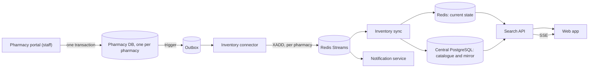

# MedLink

A federated medicine search and discovery platform. It helps people find which nearby pharmacy has a medicine in
stock. It is **not** an online pharmacy: nothing is sold, and each pharmacy keeps ownership of its own inventory
database. The central system holds a synchronized, searchable copy, not the source of truth.

## Architecture



Delivery is at least once; sync de-duplicates, rejects stale events and dead-letters malformed ones. The result is
**eventually consistent**: a change is normally visible within a few seconds, not instantly. Details:
[docs/architecture.md](docs/architecture.md).

## Stack

TypeScript npm workspaces, Fastify 5, zod, pg, ioredis, Next.js 16 and React 19, vitest, PostgreSQL 16, Redis 7.

## Layout

| Path | Purpose |
| --- | --- |
| `apps/web` | Search and discovery UI, dashboard, portal screens |
| `apps/search-service` | Search API, live stream (SSE) |
| `apps/pharmacy-portal` | Staff and admin API; writes only to the pharmacy's own DB |
| `apps/inventory-connector` | Outbox to Redis Streams |
| `apps/inventory-sync` | Stream consumer, Redis state, PostgreSQL mirror |
| `apps/notification-service` | Restock notifications |
| `apps/pharmacy-simulator` | Demo and test pharmacy nodes |
| `packages/*` | Shared db, events, redis, config, types, pharmacy operations |

## Quick start

Needs Node 22, npm and Docker. Full steps and warnings: [docs/deployment.md](docs/deployment.md).

```
npm ci
cp .env.example .env
npm run infra:up
npm run db:migrate && npm run db:seed
npm run pharmacies:setup        # fresh machines only: reseeds stock
npm run portal:seed-users
npm run dev:all                 # web :3000, API :4000, portal :4200
```

On an existing database use `npm run db:migrate` and `npm run pharmacies:migrate`, which apply only pending migrations.

## Checks

```
npm run lint
npm run typecheck
npm test
```

Results and what is not covered: [docs/verification.md](docs/verification.md).

## Roles

- **Patients** search without an account.
- **Staff** work for one pharmacy and manage only its stock, history, risk alerts and restock plans.
- **Administrators** have no pharmacy; they only approve, decline or revoke staff access. Create one with
  `npm run portal:users -- create-admin <email>` (password in `PORTAL_ADMIN_PASSWORD`).

See [docs/security.md](docs/security.md), including known gaps.

## Features

Search with match percentages and rejection reasons; node status dashboard; live updates over SSE; sales and
restocks with idempotent retries and movement history; stock-risk scores and low-stock alerts; restock planning with
CSV export; restock notifications.

## Limitations

- Eventually consistent; latency numbers are single-machine samples.
- No application containers or CI; Docker runs infrastructure only.
- Browser behaviour is covered by component tests, not end-to-end tests.
- Notification subscriptions are keyed by email without verification (documented in security.md).

## Troubleshooting

- `npm run services:status` shows which service is down.
- Stock not updating: check the connector (4301) and sync (4302) are running; events wait in the outbox meanwhile.
- Ports 3000 and 4000 busy: another instance is running.

## Documentation

[Architecture](docs/architecture.md) · [API](docs/api.md) · [Security](docs/security.md) ·
[Deployment](docs/deployment.md) · [Verification](docs/verification.md) · [Demo](docs/demo.md) ·
[Analytics dashboard](docs/analytics-dashboard.md) · [Development](docs/development.md) · [Pharmacy portal](docs/pharmacy-portal.md)
