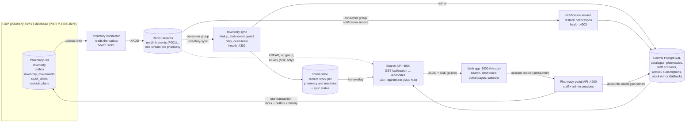

# Architecture

MedLink is a **federated medicine search and discovery platform**. It is not an online pharmacy and it does not take over a pharmacy's stock: every pharmacy keeps its own
database, which stays the authority for its inventory. MedLink keeps a synchronized, searchable copy of what each pharmacy reports, and answers searches from that copy
without querying any pharmacy.

## Components and data flow



Solid lines are the inventory pipeline. The dotted line is the SSE hub *observing* the streams: it uses plain `XREAD`, creates no consumer group and acknowledges nothing, so it cannot
disturb the sync service. **The pharmacy portal never writes Redis or the central stock mirror**: a stock change exists only as a row in the pharmacy's own database and its outbox.

## One stock change, end to end

1. A staff member records a sale or restock in the portal. **One database transaction** in that pharmacy's database locks the stock row (no overselling), updates it, and writes the
   outbox event (a trigger) and the movement-history row. All commit, or none does.
2. The connector reads unpublished outbox rows and publishes them to that pharmacy's Redis stream (`medlink:events:{P001}`, the pharmacy code is the Redis Cluster hash tag), marking a row
   published only after Redis accepted it. A Redis outage leaves events in the outbox.
3. The sync service consumes the stream through a consumer group. It ignores an event id it has already handled (**duplicates**), never lets an older event overwrite newer state
   (**stale/out-of-order**), retries failures, takes over a crashed consumer's entries, and dead-letters an event that keeps failing. It writes the current state to Redis and mirrors it to
   the central database.
4. Search overlays the Redis state on the catalogue, so a shopper sees the change; the SSE hub announces it once the sync service has marked the event done; the notification service
   (its own consumer group) turns a RESTOCK into restock notifications for people waiting for that medicine.
5. Stock-risk alerts and restock plans are evaluated and stored **in the pharmacy's own database** and are staff-only: they never travel through the public stream.

The system is **eventually consistent**. A change is visible after the connector polls (about a second by default), the sync service applies it, and a search or stream reads it; see
[verification.md](verification.md) for measured figures.

## Services and ports (local)

| Service | Port | Started by | Health |
|---|---|---|---|
| Web app (Next.js) | 3000 | `npm run web:dev` | answers HTTP |
| Search API + SSE hub | 4000 | `npm run api:dev` | `GET /api/health` |
| Pharmacy portal API | 4200 | `npm run portal:dev` | `GET /health` |
| Inventory connector | 4301 | `npm run connector:start` | `GET /health` on 127.0.0.1 |
| Inventory sync | 4302 | `npm run sync:start` | `GET /health` on 127.0.0.1 |
| Notification service | 4303 | `npm run notify:start` | `GET /health` on 127.0.0.1 |
| PostgreSQL (Docker) | 5433 | `npm run infra:up` | `pg_isready` |
| Redis (Docker) | 6379 | `npm run infra:up` | `redis-cli ping` |

`npm run dev:all` starts the six app processes with prefixed logs; `npm run services:status` reports each one's real health (a process answering is not the same as healthy).

## Who may see what

| Data | Public (search API, SSE) | Pharmacy staff (portal) | Administrator (portal) |
|---|---|---|---|
| Catalogue, public availability, prices, node synchronization status | yes | yes | n/a |
| Their own pharmacy's stock editing, movement history, risk and alerts, restock plans, CSV export | no | **own pharmacy only** | **no** |
| Who has access to which pharmacy (approve, decline, remove) | no | no | yes |
| Another pharmacy's anything | no | no | no |

See [security.md](security.md).

## Repository layout

```
apps/web                  Next.js web app (search, dashboard, portal UI, patient sign-in and calendar)
apps/search-service       public search API, ranking and matching, node status, SSE hub
apps/pharmacy-portal      staff and admin API (sessions, stock, transactions, history, risk, plans, admin)
apps/inventory-connector  outbox -> Redis Streams
apps/inventory-sync       Redis Streams -> current state (dedup, stale guard, retry, dead letter)
apps/notification-service restock notifications
apps/pharmacy-simulator   development tool: pharmacy nodes and a pipeline tracer
packages/db               PostgreSQL access, central and pharmacy migrations, seed data
packages/event-schema     event contract and Redis key conventions
packages/redis            Redis client (standalone or cluster)
packages/pharmacy-ops     pharmacy operations: sales, restocks, history, alerts, risk, plans, CSV
scripts                   dev-all, services-status, measure-latency
tests                     cross-service integration tests
docs                      this documentation
```
