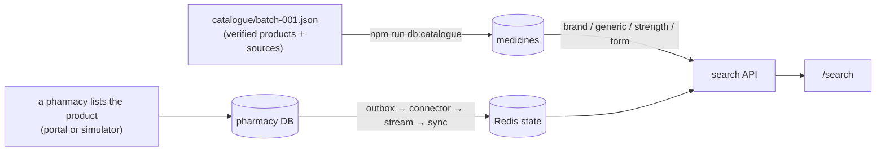

# Medicine catalogue

The central `medicines` table says **which products exist**, so they can be found. It says nothing about who stocks
them. Whether a pharmacy has a product, how many, at what price and how fresh that is comes only from that pharmacy's
own database through the usual pipeline (pharmacy DB → outbox → connector → Redis Streams → sync → Redis + the
central `inventory` mirror → search). Importing the catalogue changes no stock, no price and no pharmacy.



A product nobody lists gives **no search results**, not a "0 in stock" row: results are pharmacy offers, so there is
nothing to show until a pharmacy lists it.

## What is in a batch

`packages/db/catalogue/batch-001.json` (batch 001, verified 2026-10-22): **154 verified products** (98 brands, 56
generics) and **13 names held for manual review**. Two of the 154 were already seeded demo medicines (Dolo 650 mg is
`M002`, Telma 40 mg is `M013`); the importer matches them instead of adding them, so a first import adds **152**
products (codes up to `M167`); `--dry-run` lists them.

| Category | Products |
|---|---|
| Anti-infectives | 19 |
| Neurology and psychiatry | 18 |
| Hospital and specialty | 14 |
| Dermatology and trichology | 12 |
| Endocrinology and chronic care | 11 |
| Gastrointestinal | 10 |
| Oncology (+ supportive care) | 9 (+4) |
| Cardiology, Pain and fever, Respiratory | 8 each |
| Vitamins and nutrition | 7 |
| Allergy, Gastroenterology and hepatology, Fertility and reproductive health | 6 each |
| Nephrology, First aid and topical | 4 each |

Each record holds what `medicines` stores (`code`, `brand`, `generic`, `dosage`, `form`) plus reference data the table has
no columns for (`category`, `manufacturer`, `pack`, `sources`, `verification`, `evidence`). Those stay in the file; the
database gets only the five supported fields, and no schema change was needed.

* **Brands** are product names (`Zerodol-SP`, `Retaunch`). **Generics** use the generic name as the name (`Gabapentin
  300mg capsule`) and come from the government list below. A brand and its generic share `generic_name`, so the
  existing "same active ingredient" lookups connect them.
* **Strengths and forms are distinct products**: `Omez 20mg` and `Omez 40mg` are two rows. `dosage` uses the units the
  search understands (`mg`, `mcg`, `g`, `ml`, `iu`, `%`, joined with `/` for combinations), so a product is found by
  its strength.
* Several brands of one formula stay separate (Retaunch, Nefrosave, Nefrozon, Renosave are all N-acetylcysteine 150 mg +
  taurine 500 mg from different companies).
* No dosing instructions, indications or prices are stored.

## Where the data comes from

| `verification` | Meaning | Count |
|---|---|---|
| `official-list` | Generic name, strength and form from the Government of India's **PMBJP** (Pradhan Mantri Bhartiya Janaushadhi Pariyojana) product list, published by the Press Information Bureau as the annexure "list of 2110 generic medicines under PMBJP till 31.12.2025". The record cites the PMBJP drug code. Public government information. | 56 |
| `manufacturer-document` | A manufacturer's own product information (Alkem, GSK India, Sanofi India, Torrent, Avil/Sanofi) agrees with a pharmacy listing. | 6 |
| `multiple-sources` | Two or more independent sources, at least one a regulator, manufacturer or published label, agree. | 8 |
| `single-source` | Only one source was found (Levocet, Omez 20/40, Tegrital, Oflox, Cellcept). Worth a second source. | 6 |
| `retail-listings` | Composition, strength and form read from Indian pharmacy or distributor product pages (URLs in each record), two or more where possible. | 78 |

**Be clear about what "verified" means.** No machine-readable CDSCO register was available, so for brands the evidence is
retail listings and, where found, manufacturer documents. That confirms a product exists with that composition, strength
and form; it is not a regulator's approval, and listings sometimes disagree. Where listings disagreed on the
**manufacturer**, the manufacturer is left out of the record. Where they disagreed on **composition, strength or form**,
the name went to the review list instead.

**Licence and terms.** The government list is public information. The retail pages were read individually to confirm
facts (composition, strength, form, manufacturer, pack size); nothing was scraped in bulk and no text, image or price was
copied, and facts are not copyrightable. The URLs are kept as provenance only. The file contains no pharmacy-site
content. If a source's terms change or you want the retail evidence replaced with manufacturer or CDSCO records, the
`sources` and `verification` fields are the place to do it.

The NLEM 2022 PDF was also considered; it could not be read reliably without PDF tooling, so it was not used.

## Names held for manual review

These are in the batch with `"status": "needs-review"`. The importer **reports them and never imports them**.

| Name | Why |
|---|---|
| **Viotace** | No product page found by any search. The closest names (Viokace, a US pancrelipase tablet; Viropace; Vitrace) are different products. Confirm the exact name, composition and pack from a pack photo, a manufacturer catalogue or the CDSCO register, then add a verified record. |
| Gabapin, Letroz, Clopitab, Jalra, Donep, Bicalox | No brand page found naming strength and maker (Femara 2.5 mg is imported for letrozole). |
| Neurobion Forte, Burnol, Foracort, Voveran, Oleanz, Arcoxia | Listings disagree on component amounts, strength expression, dosage form, or the Indian strength. |

**Retaunch** is verified and imported: N-acetylcysteine 150 mg + taurine 500 mg tablet, Medigen Life Sciences, strip of
10, from four pharmacy listings.

## Commands

```
npm run db:catalogue -- --dry-run     # report what would happen; writes nothing
npm run db:catalogue                  # import packages/db/catalogue/batch-001.json
npm run db:catalogue -- path/to/other-batch.json
```

It prints `imported`, `already present`, `needs review` and `rejected` counts and a line for each rejected or held-back
name. It runs in one transaction; a `--dry-run` uses a read-only transaction and issues no INSERT, so it leaves the medicine id sequence untouched too. It is **idempotent**: a second run imports nothing. It only ever inserts missing
products:

* a record whose brand + strength + form already exists (any case) is *matched*, and left alone;
* it is *rejected* if the existing product has a different code or generic name, if its code belongs to another product,
  if it duplicates another record in the batch, or if it is malformed (bad code, a strength the search cannot read,
  missing source, unknown `verification`);
* it never updates a medicine and never touches `inventory`, so pharmacy stock and prices cannot change.

Nothing runs automatically, and **no migration is involved**. `npm run db:seed`/`db:reset` still load only the 15 demo
medicines and their starting stock.

Inspect what was imported:

```sql
SELECT code, brand_name, generic_name, dosage, form FROM medicines WHERE code > 'M015' ORDER BY code;
SELECT count(*) FROM inventory WHERE medicine_id IN (SELECT id FROM medicines WHERE code > 'M015');  -- 0 until pharmacies list them
```

## From import to the screen

1. `npm run db:catalogue` puts the products in `medicines`. The search API reads that table on each request, so no
   cache needs clearing and no service needs restarting.
2. `/search?q=Retaunch` now finds the product but shows **nothing**, because no pharmacy lists it.
3. A pharmacy lists it: in the portal ("add a medicine" now offers every catalogue product the pharmacy does not
   carry) or `npm run simulator`, `add P001 Retaunch 20 190`. That is an insert into the pharmacy's own database; the
   trigger records a `MEDICINE_ADDED` event in the outbox in the same transaction, and the connector → Redis Stream
   `medlink:events:{P001}` → sync service carry it to Redis and the central mirror.
4. Within moments `/search?q=Retaunch` shows that pharmacy, with the quantity, price and freshness it reported and
   `live` as the source. Other pharmacies stay absent.

The pharmacy itself must hold the product in its own database before anything is shown; there is no "stock all
pharmacies" step. Pharmacy databases refer to a product by its code only, so no change to their schema was needed.
**Import the catalogue before a pharmacy lists a new product**: the central mirror joins on the `medicines` row, so an
event for a product that is not in `medicines` reaches Redis but is not mirrored to PostgreSQL (existing behaviour, not
changed here).

## Adding another batch

Copy the format of `batch-001.json` into `batch-002.json`. Give new records the next free `M` codes (never reuse or
renumber), list every source URL, set `verification` honestly, and put anything uncertain under `needs-review`. Run
`--dry-run` first. `npx vitest run packages/db/test/catalogue.test.ts` checks the shipped batch; point it at a new file
by extending `readCatalogueBatch` if you add more than one.

## Removing the imported products

Only safe for products no pharmacy lists (`inventory` rows would be removed with the medicine). Codes `M002` and `M013`
belong to the seeded demo medicines and are excluded:

```sql
DELETE FROM medicines m
WHERE m.code > 'M015'
  AND NOT EXISTS (SELECT 1 FROM inventory i WHERE i.medicine_id = m.id);
```

On a fresh development database `npm run db:reset` also returns to the 15 demo medicines.

## Limits

* Search matches names and strengths as typed (case-insensitive, any part of the brand or generic name; a bare number is
  matched against the strength). There is no alias table, so a misspelling ("Cetrizine") or an informal name does
  not match; a space for a hyphen does ("montair lc"). Adding verified aliases would need a new table and a migration; none
  was added because no alias set could be verified.
* `Syndopa 110` is stored as `Syndopa` (100 mg/10 mg): the "110" in the trade name is the combined strength, and the
  search treats a number as a strength.
* A generic is listed under its generic name, so the result card shows the same text as brand and generic.
* There is no way, in the search API, to see that a product is catalogued but unstocked; it simply has no offers.
