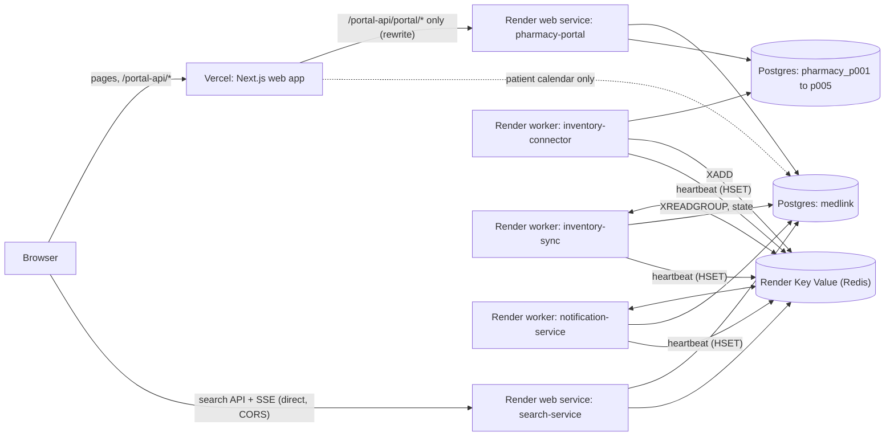

# Setup and deployment

Two parts: [local development](#local-development) and [cloud deployment on Vercel and Render](#cloud-deployment-vercel--render).

**Legend.** **Verified** means checked in this repository (a test, or a real production build run locally). **[V]** means it can only be confirmed on the real
Vercel or Render account, and must be checked there. Nothing in this document has been run against a cloud service.

---

## Local development

Requirements: Node 22, npm, Docker.

```
npm ci
cp .env.example .env            # then set POSTGRES_PASSWORD and the other required values
npm run infra:up                # Postgres (5433) and Redis (6379) in Docker
npm run db:migrate              # central database migrations
npm run db:seed                 # central catalogue and pharmacies
npm run pharmacies:setup        # creates and seeds the five pharmacy databases
npm run portal:seed-users       # p001@pharmacy.test ... p005@pharmacy.test
npm run db:catalogue            # optional: import the larger catalogue
npm run dev:all                 # starts every service
```

Warning: `pharmacies:setup` and `pharmacies:reset` **reseed stock**. Use them on a fresh machine only.

Existing environments apply only what is pending, which is safe on live data:

```
npm run db:migrate              # central (001 to 008)
npm run pharmacies:migrate      # the five pharmacy databases (001 to 005)
```

Order: central migrations, then pharmacy migrations, then restart services. Already-applied migrations are never edited.

| Service | Port |
| --- | --- |
| Web | 3000 |
| Search API | 4000 |
| Pharmacy portal | 4200 |
| Inventory connector / sync / notification (health) | 4301 / 4302 / 4303 |
| Postgres / Redis | 5433 / 6379 |

`npm run services:status` checks them. Locally nothing in this document changes how anything behaves: every cloud setting below is optional and unset by default.

`docker-compose.yml` runs infrastructure only (Postgres, Redis, an optional Redis Cluster).

---

## Cloud deployment (Vercel + Render)

### Architecture



- The browser talks to **Vercel** for pages and for the pharmacy portal (through a same-origin proxy), and **directly to the search API** for search and the live stream (SSE).
- The five backend processes talk to each other **only through Postgres and Redis**. The one exception was the search service reading the workers' health over `127.0.0.1`; that is replaced by Redis heartbeats (below).
- The portal never touches Redis, and search, sync and notification never hold a pharmacy database credential.
- The temporary domains (`*.vercel.app`, `*.onrender.com`) are different sites. That is why the portal is proxied (below) instead of being called cross-site.

### What was verified here

| Item | How |
| --- | --- |
| `next build` succeeds (Next 16.3.8, 15 routes) with the proxy configured | Run for real into a throwaway output directory (`NEXT_DIST_DIR`), then removed. |
| The proxy forwards method, query, body, headers and cookies; passes `Set-Cookie`, status codes, `Retry-After` and CSV headers back unchanged; forwards **only** `/portal-api/portal/*` | `next start` of that build against a stand-in upstream, with curl: login, session persistence, authenticated calls, logout, revoked and missing session (401), 403, 429, error bodies, CSV. |
| The upstream address and `localhost` addresses are not in the browser bundles | Searched the built `static/` files. |
| The rewrite rules, upstream validation, client base URL, `TRUST_PROXY`, heartbeats and worker-health classification | Unit and integration tests (`apps/web/src/server/portal-upstream.test.ts`, `apps/web/src/lib/portal-base.test.ts`, `apps/pharmacy-portal/test/proxy.test.ts`, `packages/db/test/heartbeat.test.ts`, `apps/search-service/test/heartbeat-health.test.ts`). |

Still **[V]** (needs the real platforms): Vercel's rewrite behaviour with `Set-Cookie`, `Host` and `X-Forwarded-For`; Render's port, health and SSE proxying; database privileges; Valkey and eviction settings; TLS to Postgres. Section "Manual steps" lists each.

### Vercel (web app)

| Setting | Value |
| --- | --- |
| Root Directory | `apps/web` (the app imports nothing from outside it; it has no `@medlink/*` dependencies) |
| Install | Vercel's default: it detects the npm workspace and installs from the root `package-lock.json`. Keep "include source files outside the Root Directory" on. |
| Build | `npm run build` (`next build`). Do **not** set `NEXT_DIST_DIR` (the output must be `.next`). |
| Node.js | **22.x** (set it in the project settings; the repo also has `.node-version`) |

Environment variables. The first four are read when the app is **built**: change one, redeploy.

| Variable | Kind | Required | Purpose |
| --- | --- | --- | --- |
| `PORTAL_UPSTREAM_URL` | server-side (not `NEXT_PUBLIC_`) | yes | The portal's Render origin, e.g. `https://medlink-portal.onrender.com`. https only, no path, query or credentials; a malformed value fails the build. If unset, `/portal-api` is simply not proxied (the build warns) and the portal will not work. |
| `NEXT_PUBLIC_API_URL` | public, build-time | yes | The search API's Render origin. |
| `NEXT_PUBLIC_SITE_URL` | public, build-time | yes | The web app's public origin (canonical links). |
| `NEXT_PUBLIC_PORTAL_URL` | public | **leave unset** | If set it overrides the proxy and the browser would call that address directly. |
| `AUTH_SECRET`, `AUTH_GOOGLE_ID`, `AUTH_GOOGLE_SECRET` | **secret**, server-only | for Google sign-in | `AUTH_SECRET`: `openssl rand -base64 32`. Google sign-in needs all three. `AUTH_SECRET` alone (with `DATABASE_URL`) enables email-and-password sign-in only; with neither, "Sign in" is hidden. |
| `DATABASE_URL` | **secret**, server-only | for the patient calendar **and for email-and-password sign-in** | The web server's own connection to the central database. Use the **external** Postgres URL with TLS. Without it email sign-in is not offered in production. |
| `AUTH_URL` | optional | no | Only if Auth.js cannot work out its own address. |

**Google OAuth.** In Google Cloud Console, add the authorized redirect URI `https://<your-vercel-domain>/auth/callback/google` (Auth.js is mounted at `/auth`) and the origin `https://<your-vercel-domain>`. Preview deployments need their own entries.

### The same-origin portal proxy

- The browser calls `/portal-api/portal/...` on the **web app's own origin**. In production `PORTAL_URL` defaults to `/portal-api` (`apps/web/src/lib/portal.ts`); in development and tests it is still `http://localhost:4200`, so local behaviour is unchanged.
- `next.config.ts` rewrites exactly `/portal-api/portal/:path*` to `PORTAL_UPSTREAM_URL/portal/:path*` (`apps/web/src/server/portal-upstream.ts`). On Vercel this is a platform rewrite, so it costs no function invocations.
- The session cookie (`medlink_portal`: `HttpOnly`, `SameSite=Lax`, `Secure` in production, no `Domain`) is set by a response the browser received from **its own origin**, so it is first-party and none of those attributes is loosened. No wildcard CORS, no `SameSite=None`, no CORS involved in portal calls at all.
- **Not an open proxy.** The upstream host is fixed in the rule (a server-side variable the browser cannot influence); only a path is substituted; any other path under `/portal-api` returns 404 and never reaches the upstream. The upstream is validated at build time (https only, `http` only for localhost, no credentials, no path).
- Staying public: the search API and the live stream are still called directly by the browser (they carry no credentials), so `CORS_ORIGINS` on the search service must list the web app's exact origin.
- The portal's own `CORS_ORIGINS` should still list the web origin (harmless, and needed if anything ever calls the portal cross-origin).
- **Login throttling behind proxies.** The portal limits sign-in attempts per account and per address. Behind Vercel and Render every request arrives from a proxy, so set `TRUST_PROXY` on the portal to the number of proxies in front of it (probably `2`: Vercel, then Render). Too low: all visitors share one address and the per-address limit (40 attempts per 15 minutes) can lock everyone out together. Too high: a visitor can forge the address (the per-account limit still applies). **[V]** check with real requests which number gives each visitor their own address; leave it unset until you have.

### Render services

All five are native Node services (no Docker). **Build command for all:** `npm ci --include=dev` (the services run from TypeScript source with `tsx`, which is a dev dependency). Set `NODE_VERSION=22`. Leave the Root Directory as the repository root.

| Service | Type | Start command | Health |
| --- | --- | --- | --- |
| `medlink-search` | Web Service | `npm run start -w @medlink/search-service` | `GET /health` (200, or 503 when the database is down) |
| `medlink-portal` | Web Service | `npm run start -w @medlink/pharmacy-portal` | `GET /health` |
| `medlink-connector` | Background Worker | `npm run start -w @medlink/inventory-connector` | none (heartbeat to Redis) |
| `medlink-sync` | Background Worker | `npm run start -w @medlink/inventory-sync` | none (heartbeat to Redis) |
| `medlink-notify` | Background Worker | `npm run start -w @medlink/notification-service` | none (heartbeat to Redis) |

The workers (and, for live streaming, the search service) must run **continuously**: the connector polls the outbox every second, the sync service and notification service hold blocking consumer-group reads, and the notification service sweeps unsent alerts. A service that sleeps stops the pipeline (events wait safely in the pharmacy outboxes, but nothing reaches search). Use an always-on instance type for all five. **[V]** current Render plans: background workers are not on the free tier, free web services sleep when idle, and free databases may expire.

Port and bind settings (both web services default to `127.0.0.1`, which Render cannot reach):

- `HOST=0.0.0.0` on both.
- Search reads `PORT`. **The portal reads `PORTAL_PORT`, not `PORT`.** Set both to the port Render expects (default `10000`): `PORT=10000` and `PORTAL_PORT=10000`. (Do not make the portal fall back to `PORT`: a shared `.env` locally sets `PORT=4000` for the search service.)
- `NODE_ENV=production` on the portal makes its cookie `Secure` and makes `PORTAL_SESSION_SECRET` mandatory.
- Workers' own health endpoints are not needed on Render: set `HEALTH_PORT_CONNECTOR=off`, `HEALTH_PORT_SYNC=off`, `HEALTH_PORT_NOTIFY=off`.
- Use stable consumer names (`SYNC_CONSUMER`, `NOTIFY_CONSUMER`) so a restart reclaims its own pending events; a rolling deploy may briefly run two instances, which the consumer group and de-duplication handle.

### Worker health (heartbeats)

The search service used to read the workers' health over `http://127.0.0.1:<port>/health`, which cannot work across Render services. Workers now optionally write a **heartbeat** to Redis, and the search service reads it. Nothing needs an inbound port, and the dashboard's `GET /api/nodes` contract is unchanged except for one additional value.

- **Worker side** (`WORKER_HEARTBEAT=redis` on connector, sync and notification): every `WORKER_HEARTBEAT_INTERVAL_MS` (default 10 s) it stores its health report, stamped with the time, in the hash `medlink:health:<service>` under its own instance name, and renews the key's expiry. It never throws: a Redis failure is logged once (and once on recovery) and the worker carries on. A clean shutdown removes its record.
- **Search side** (`WORKER_HEALTH=redis`): reads those hashes. Local default is `WORKER_HEALTH=http` (the old behaviour); `off` checks nothing.

| State | Meaning | Shown as |
| --- | --- | --- |
| healthy | recent heartbeat, says it is ready | sync service `ready`; the connector's per-pharmacy backlog and database state are used |
| unhealthy | recent heartbeat, says it is **not** ready | sync service `not-ready` (quiet nodes `degraded`); connector reports its own problems (database down, polling failing) |
| stale | heartbeats exist but the newest is older than `WORKER_HEALTH_STALE_AFTER_MS` (default 35 s) | `meta.syncService` / `meta.connector` = `stale`; quiet nodes `unknown`, no remembered backlog |
| unreachable | no heartbeat, or Redis cannot be read | `unreachable`; quiet nodes `unknown` |

The newest instance wins, so a leftover record from a previous deploy cannot make a healthy service look stale; a record from the future (broken clock) is not trusted. Compare clocks only to within the stale window, so keep it well above the heartbeat interval. Details: [node-status.md](node-status.md).

Alternative, if you prefer HTTP: Render **private services** can expose the health endpoint on the private network. Set `HEALTH_HOST=0.0.0.0` and a port on the worker, and `WORKER_HEALTH_URL_CONNECTOR` / `WORKER_HEALTH_URL_SYNC` on the search service. Workers (as opposed to private services) have no inbound network, so heartbeats are the default recommendation.

### Databases (one PostgreSQL instance, six databases)

One instance with six logical databases: `medlink` (central) and `pharmacy_p001` to `pharmacy_p005`. Locally this is exactly the layout (about 8 MB each). Each pharmacy database has its own connection URL, and no query spans two of them.

- **Privileges [V].** `pharmacies:setup` (not used in the cloud) would create a role and database per pharmacy and needs `CREATEROLE` and `CREATEDB`. A managed Postgres user may not have them. If it does not, create the five extra databases from the Render dashboard or `psql`, and either create one role per pharmacy there, or use the one role for all six (isolation then rests on separate databases and URLs, not on roles).
- **Connection budget [V].** Pool maximums add up to about 145 connections in the worst case (search 10; portal 10 + 5×10; connector 5×10; sync 10; notification 10; web 5 per instance). Check `SHOW max_connections` on the chosen plan; Vercel serverless can multiply the web pool. Pools open connections lazily and most stay idle.
- **TLS [V].** `createPool` takes only a connection string, so TLS comes from the URL (`?sslmode=require`). How the `pg` driver treats `sslmode=require` against Render's certificate chain is not verified; test it from Vercel and from a worker, and adjust the URL (not the code) if needed. Use Render's **internal** URL for services on Render and the **external** URL for Vercel. Check the database's inbound access rules allow Vercel [V].
- **Migrations.** `npm run db:migrate` (central) and `npm run pharmacies:migrate` (all configured pharmacy databases) apply only pending files, in order, each in a transaction under an advisory lock. Run them as a one-off from a machine with the cloud URLs in its environment, or as a Render job, never as part of a service start.
- **Never run** `db:seed`, `db:reset`, `pharmacies:setup` or `pharmacies:reset` against a cloud database: they reseed or overwrite stock, prices and profiles.

### Redis (Render Key Value)

- Standalone: `REDIS_MODE` unset (default) and `REDIS_URL` set. Use Render's **internal** URL (`redis://`; ioredis also accepts `rediss://`). The Redis cluster settings and `npm run test:cluster` do not apply; hash tags such as `{P001}` are harmless on a single node.
- MedLink uses: `XADD ... MAXLEN ~`, `XGROUP CREATE ... MKSTREAM`, `XREADGROUP` (blocking), `XAUTOCLAIM`, `XPENDING`, `XACK`, `XINFO GROUPS`, `XLEN`, `XRANGE`/`XREVRANGE`/`XREAD`, Lua `EVAL` (1 and 4 keys), `MULTI`/`EXEC`, hashes, sets and `SET ... PX`. All are Redis 7 commands; Valkey is Redis-compatible. **[V]** confirm the Valkey version and that each works on the instance (a short check with `redis-cli` is enough).
- **Set `maxmemory-policy` to `noeviction` [V].** Locally it is `noeviction`. An LRU policy could evict stream entries or inventory state and silently lose updates, which this system must never do. Also confirm **persistence** on the chosen plan [V]: without it a restart empties Redis.
- Memory: streams are capped at about 100,000 entries per pharmacy (`REDIS_KEY_PREFIX`-namespaced); local use is a few MB.
- **Start empty.** There is no tool to rebuild Redis from the pharmacy databases. See the migration plan.

### Environment-variable matrix

Services: **Web** (Vercel), **Search**, **Portal**, **Conn**ector, **Sync**, **Notify**. S = secret, P = public, SS = server-side only. Use placeholders; never commit real values.

| Variable | Used by | Kind | Req. | Purpose / placeholder |
| --- | --- | --- | --- | --- |
| `DATABASE_URL` | Web, Search, Portal, Sync, Notify | S | yes (Web: for the calendar) | central DB: `postgres://<user>:<password>@<host>:5432/medlink?sslmode=require` |
| `PHARMACY_P001_DATABASE_URL` … `P005` | Portal, Conn | S | yes, all five | `postgres://<user>:<password>@<host>:5432/pharmacy_p001?sslmode=require`. **Not** for Search, Sync, Notify or Web. |
| `REDIS_URL` | Search, Conn, Sync, Notify | S | yes | `redis://<internal-host>:6379` |
| `REDIS_MODE` | same | P | no | leave unset (standalone) |
| `REDIS_KEY_PREFIX` | Search, Conn, Sync, Notify | P | no | must be identical across them; default `medlink` |
| `HOST` | Search, Portal | P | yes | `0.0.0.0` |
| `PORT` | Search | P | yes | `10000` |
| `PORTAL_PORT` | Portal | P | yes | `10000` |
| `NODE_ENV` | Portal (and all) | P | yes | `production` |
| `NODE_VERSION` | all Render services | P | yes | `22` |
| `PORTAL_SESSION_SECRET` | Portal | S | yes | at least 16 characters; `openssl rand -base64 32` |
| `PORTAL_SESSION_HOURS` | Portal | P | no | default 8 |
| `TRUST_PROXY` | Portal | P | recommended | hops, e.g. `2`; see above |
| `CORS_ORIGINS` | Search, Portal | P | yes | exact web origin, e.g. `https://<project>.vercel.app` (comma-separated, no wildcards; a preview deployment is a different origin) |
| `LOW_STOCK_THRESHOLD` | Search, Portal | P | no | keep equal on both (default 5) |
| `RANK_WEIGHT_*`, `RANK_MAX_DISTANCE_KM`, `LIVE_STOCK` | Search | P | no | ranking and live-stock overlay |
| `WORKER_HEALTH` | Search | P | yes on Render | `redis` |
| `WORKER_HEALTH_STALE_AFTER_MS` | Search | P | no | default 35000 |
| `WORKER_HEALTH_URL_CONNECTOR`, `WORKER_HEALTH_URL_SYNC` | Search | P | no | only for HTTP health over a private network |
| `WORKER_HEARTBEAT` | Conn, Sync, Notify | P | yes on Render | `redis` |
| `WORKER_HEARTBEAT_INTERVAL_MS` | Conn, Sync, Notify | P | no | default 10000 (1000 to 120000) |
| `WORKER_INSTANCE` | Conn, Sync, Notify | P | no | stable instance name (default host and pid) |
| `HEALTH_PORT_CONNECTOR`, `HEALTH_PORT_SYNC`, `HEALTH_PORT_NOTIFY` | Conn, Sync, Notify | P | no | `off` on Render |
| `HEALTH_HOST` | Conn, Sync, Notify | P | no | default `127.0.0.1` |
| `CONNECTOR_PHARMACIES`, `CONNECTOR_POLL_INTERVAL_MS`, `CONNECTOR_BATCH_SIZE` | Conn | P | no | defaults are fine |
| `SYNC_CONSUMER`, `SYNC_GROUP`, `SYNC_*`, `SYNC_MIRROR` | Sync | P | no | set `SYNC_CONSUMER` to a stable name |
| `NOTIFY_CONSUMER`, `NOTIFY_*` | Notify | P | no | set `NOTIFY_CONSUMER` to a stable name |
| `EMAIL_DELIVERY_ENABLED` | Notify | P | yes | **`false` for the first deployment** |
| `SMTP_USER`, `EMAIL_FROM` | Notify | P | with email | sender (a Gmail account) |
| `SMTP_PASS` | Notify | S | with email | Gmail App Password |
| `NEXT_PUBLIC_SITE_URL` | Notify, Web | P | yes | web origin; used for links in emails |
| `LOG_LEVEL` | all | P | no | default `info` |
| `PORTAL_UPSTREAM_URL` | Web | SS (build-time) | yes | portal origin |
| `NEXT_PUBLIC_API_URL` | Web | P (build-time) | yes | search API origin |
| `AUTH_SECRET`, `AUTH_GOOGLE_ID`, `AUTH_GOOGLE_SECRET` | Web | S, SS | for sign-in | see Vercel section |

Not set in the cloud: `PORTAL_DEV_PASSWORD`, `PORTAL_ADMIN_PASSWORD` (command line only), `NEXT_PUBLIC_PORTAL_URL`, `NEXT_DIST_DIR`, any `POSTGRES_*` (local Docker only).

### Migrating the existing local data (documented only; not run)

Goal: the cloud starts with the local pharmacy stock, prices, movement history, alerts, plans, medicines and pharmacy records, **without** development staff accounts or personal data, with an **empty** Redis, and without publishing any event twice.

Local baseline to compare against (taken from the local databases; recount before you start): central 8 migrations (the last, 008, adds `credential_accounts` and `auth_throttle`, which are empty or excluded), 5 pharmacies, 167 medicines, 68 inventory rows; per pharmacy P001–P005, 5 pharmacy migrations; stock rows 14/14/13/14/13 (units 383/312/325/366/348); movements 0/13/0/0/0; alerts 0/7/6/0/5; plans 0/1/0/0/0; unpublished outbox 0 everywhere.

1. **Quiesce locally.** Stop the connector and the portal (nothing may write while you dump). Confirm `SELECT count(*) FROM outbox WHERE published_at IS NULL` is `0` in all five pharmacy databases. If it is not, let the connector publish first (locally), then stop it.
2. **Dump** each database from the local container (custom format), e.g.:
   ```
   docker exec medlink-postgres-1 sh -c 'pg_dump -U "$POSTGRES_USER" -Fc -d pharmacy_p001' > pharmacy_p001.dump
   ```
   For the central database leave out the **data** of the personal tables (their structure is still dumped):
   ```
   pg_dump -Fc -d medlink --exclude-table-data=pharmacy_users --exclude-table-data=users \
     --exclude-table-data=restock_subscriptions --exclude-table-data=notifications \
     --exclude-table-data=patients --exclude-table-data=medicine_calendar_entries \
     --exclude-table-data=credential_accounts --exclude-table-data=auth_throttle
   ```
   This drops the development staff password hashes, the real accounts, patient identities, email-and-password patient accounts and their attempt counters, restock subscriptions (email addresses) and notifications. Keep `medicines`, `pharmacies`, `inventory` and `schema_migrations`.
3. **Create the six empty databases** in the cloud instance (see Privileges). Restore each dump into its own empty database with `pg_restore --no-owner --no-privileges -d <cloud url>` (add `--role` if you use one shared role).
4. **Migrate.** With the cloud URLs in the environment, run `npm run db:migrate` and `npm run pharmacies:migrate`. Both should report nothing pending, because `schema_migrations` was restored; if anything is pending, it is applied additively.
5. **Staff accounts.** Create fresh accounts later with strong, unique passwords (`npm run portal:users -- create-admin <email>` with `PORTAL_ADMIN_PASSWORD` on the command line; staff request access and an administrator approves). Do **not** run `portal:seed-users` with the default dev password.
   - **Identity sequence.** Movements and plans keep the numeric id of the account that made them (`inventory_movements.actor_user_id`, `restock_plans.created_by_user_id`) with no foreign key. Before creating any account, set the `pharmacy_users` id sequence **above the largest such id** in the five pharmacy databases, so a new account never looks like the author of an old movement ("by you" in the history). Check how the dump handled the sequence rather than assuming.
6. **Verify** against the baseline: row counts of every table in all six databases; per pharmacy `SUM(quantity)` and a checksum of `(medicine_code, quantity, price)` ordered by code; movements, alerts and plans counts and a sample of their rows; the 167 medicines and 5 pharmacies; the central `inventory` rows equal the pharmacy stock (the mirror); outbox rows all published.
7. **Redis starts empty. Why that is safe and what it means.** The central `inventory` mirror, restored from the dump, answers search until new events arrive (search falls back to it for any medicine Redis does not know). Dashboard counters (events processed, duplicates) start again from zero. Nothing is republished, because every outbox row is already marked published; the connector publishes only unpublished rows.
8. **No duplicate events.** Start the cloud connector only after the cloud Redis, sync and notification services are running; never point a connector at a database whose events were already published from the local stack to the same Redis. Never reset `published_at`.
9. **Keep email off.** `EMAIL_DELIVERY_ENABLED=false` for the first deployment, so nothing can be emailed while the system settles. (If you ever rebuild Redis by replaying events, a fresh notification consumer group re-reads old restock events; keep email off for that too.)
10. **Forbidden commands**, again: `db:seed`, `db:reset`, `pharmacies:setup`, `pharmacies:reset`.

### Security considerations

- The portal's cookie keeps `HttpOnly`, `SameSite=Lax` and `Secure`; the proxy exists so that none of it has to be relaxed. The portal still reads the role from the database on every request.
- The proxy accepts only `/portal-api/portal/*` and one validated upstream. The upstream URL is a server-side variable and was verified absent from the browser bundles.
- Use unique strong values for `PORTAL_SESSION_SECRET`, `AUTH_SECRET`, database passwords and `SMTP_PASS`; they live only in Render and Vercel settings, never in the repository.
- Search, sync and notification have no pharmacy database credentials; the portal has no Redis access; the browser has neither.
- Redis and Postgres should be reachable only over the private network where possible (Vercel needs the Postgres external URL for the calendar only: restrict it, and consider moving that feature behind the search service later).
- `CORS_ORIGINS` lists the exact web origin; no wildcard. `X-Forwarded-For` is trusted only to the number of hops in `TRUST_PROXY`.
- Worker heartbeats carry the same report as the old health endpoint: counts and states, never connection strings or addresses.

### Manual steps still required

1. Create the Postgres instance (check privileges, `max_connections`, TLS, inbound access) and Key Value (set `noeviction`, check persistence). **[V]**
2. Restore and verify the data (above).
3. Create the five Render services with the settings above and environment variables from the matrix, and note the two web-service URLs.
4. Create the Vercel project (root `apps/web`, Node 22.x), set the environment variables including `PORTAL_UPSTREAM_URL`, and deploy. Then set `CORS_ORIGINS` on both Render web services to the Vercel origin and add the Google redirect URI.
5. Check: search results and the live stream from the Vercel site; portal sign-in, a reload (session persistence), a sale or restock arriving in search, sign-out; `GET /api/nodes` showing workers `ready` (not `stale`/`unreachable`); `req.ip` per visitor (sets `TRUST_PROXY`). **[V]**
6. Only after all that, turn email on.

### Known limitations

- No `render.yaml`, Dockerfile or CI is provided. The services are native Node; a Dockerfile would need the repository root as its build context (the workspaces share one lockfile).
- The web app's calendar connects to the central database from Vercel (serverless connection counts, external TLS, access rules). The rest of the web app does not.
- Preview deployments on Vercel are different origins and are not in `CORS_ORIGINS`; the search API will refuse them.
- The heartbeat compares clocks across machines: keep the stale window well above the interval.
- No backup or high-availability configuration is provided.
